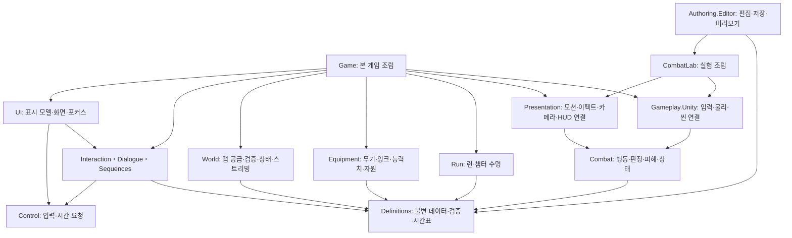

# 게임플레이 실험을 위한 목표 아키텍처

[분야 개요](README.md)

이 문서는 전면 리팩토링의 **설계 제안**이다. 현재 구현 설명은 [코드 구조](architecture.md), 현재 게임 규칙은 [전투 명세](../../design/combat/rules.md)와 [무기·잉크](../../design/equipment/rules.md)를 따른다. 아래는 목표 전체이며 실제 적용 범위와 남은 도구는 코드 구조 문서에서 구분한다. 제안된 편집 기능이 기존 수치나 미정 제품 규칙을 확정하지 않는다.

## 1. 목표와 선택

최우선 목표는 **값 수정 → 즉시 적용 → 동일 조건 재시도 → A/B 비교 → 원본에 저장**의 반복 비용을 낮추는 것이다. 스프라이트 한 장의 유지 시간, 공격 준비·활성·회복, 판정 범위, 이동기 속도를 바꾸는 데 C# 수정·재컴파일·씬 재진입이 필요하지 않아야 한다.

추천 구조는 **기능별 모듈 + 데이터 기반 행동 타임라인 + Unity와 분리한 전투 규칙 + 공통 런타임을 사용하는 실험장**이다.

- GameObject/MonoBehaviour는 씬 연결·물리·렌더링·입력을 담당한다. 전투 규칙과 실행 상태는 일반 C# 객체가 담당한다.
- 기본 공격·특수·대시는 공통 실행기를 사용하되, 차지·재입력 접근·미사일 비행 같은 동작은 명시적인 전용 실행 정책으로 확장한다.
- 프레임 표시와 타격은 같은 행동 시간축을 읽는다. 피해 발생의 권한은 전투 실행기에 둔다.
- 편집 원본, 실행용 정의, 현재 실행 상태를 구분한다. ScriptableObject를 사용해도 런타임 가변 상태와 영구 수치 원본을 겸하지 않는다.
- 전면 ECS 전환, 범용 노드 스크립팅, 전역 서비스 조회, 모든 상호작용의 이벤트 버스화는 초기 범위에 넣지 않는다. 현재 실험 속도에 직접 기여하는 경계부터 만든다.

성공 기준은 파일 수나 패턴 도입 수가 아니다. 프레임 시간·범위·돌진 속도의 세 가지 실험이 코드 수정 없이 가능하고, 재시작 후에도 저장값으로 재현되며, 시험장과 본 게임에서 같은 결과를 내는지가 기준이다.

## 2. 현재 구현에서 출발할 지점

| 현재 근거 | 유지할 기반 | 해결할 문제 |
|---|---|---|
| `CombatCore.cs` | 순수 C# 피해·충전·타격 중복·점프 예약 규칙 | 이동·점프 상수와 일부 규칙 수치가 코드에 고정됨 |
| `CombatPlayer.cs` | 입력 우선순위·예약·취소 규칙 | 키보드 입력, 행동 선택, 이동, 장비, 대시 수치, 낙사 처리가 한 객체에 결합됨 |
| `CombatCast.cs`와 partial | 시간 구간 교차 검사, 독립 효과, 발동 시 소비 | 종류별 문자열 분기와 개별 동작 상태가 공통 실행기를 계속 확장함 |
| `CombatActor.cs` | 몸/피격 분리, 지형 스윕, 고정 피격 기하 | 이동·피해·상태이상·시각 표현이 결합됨 |
| `CombatArena.cs` | 중앙 갱신, 시험장, 디버그 표시 | 런타임 스케줄링, 물리 질의, 리소스 로드, 공간 생성, UI, 캡처가 결합됨 |
| `CharacterAnimationV2.cs` | 프레임별 `seconds`, 접촉 시점 동기화 | `SourceTime()`의 접촉 전후 시간 보정으로 원본 프레임 시간과 실제 표시 시간이 달라짐 |
| `GameComposition.cs` | 본 게임에서 공통 전투 사용, HUD 인터페이스 | 시험장 역할을 가진 `CombatArena`에 본 게임도 의존함 |
| 기존 JSON·생성기 | 수치 원본과 생성물 구분 | 수정·검증·실행 중 반영·원본 저장을 잇는 편집 흐름이 없음 |

공통 런타임과 순수 규칙은 추출해 활용한다. 폴더만 이동하거나 partial 파일만 늘리는 것은 책임 분리가 아니다. 현재 구현과 명세가 다른 부분은 이식 중 조용히 승계하거나 수정하지 않고, 충돌을 별도로 식별해 명세에 근거해 처리한다.

## 3. 모듈과 의존성

아래는 논리적인 책임 구분이다. 최종 폴더·레이어·공개 계약·객체 소유권은 [프로젝트 목표 구조](project-structure.md)를 따른다. `Interaction`·`Dialogue`·`NarrativeState`는 `Narrative` 모듈에, `Gameplay.Unity`는 기능별 Unity 어댑터와 Integration에 배치한다. 무기 인스턴스·능력치·재고는 Equipment가 소유하고 Run은 그 수명을 연결한다.

다음은 목표 코드 의존성이다. 화살표는 호출·참조 방향이며 이벤트 흐름 전체를 뜻하지 않는다.



| 모듈 | 책임과 경계 |
|---|---|
| `Definitions` | 안정적인 콘텐츠 ID, 이동/행동/무기/모션 정의, 스키마 검증, 시간표 해석. UnityEngine 객체를 참조하지 않음 |
| `Combat` | `CombatSimulation`, 입력 명령 처리, `ActionRunner`, 피해·상태·자원, 독립 효과 상태. 씬·UI·키보드를 모름 |
| `Gameplay.Unity` | 입력 수집, `IWorldQuery` 구현, 캐릭터 이동의 지형 접촉 처리, 콜라이더와 위치 동기화, 스폰·디스폰 연결 |
| `Presentation` | 상태 스냅샷과 확정 이벤트로 스프라이트·VFX·SFX·카메라를 갱신. 피해·쿨타임·실제 위치를 결정하지 않음 |
| `Game` | 본 게임의 조립 진입점. World·UI·Run과 전투를 연결 |
| `CombatLab` | 같은 전투의 테스트 시나리오, 임시 수정값, A/B, 리셋, 기록. 일반 게임은 이 모듈을 참조하지 않음 |
| `Authoring.Editor` | 원본 JSON 편집, Undo/Redo, 시간표·판정 미리보기, 검증·저장. 플레이 중 시험장에 정의 스냅샷 전달 |
| `Run` | 런 수명·챕터 진행과 장비/월드 세션의 수명 연결. 실제 보상·저장 정책은 후속 기획 범위 |
| `Equipment` | 무기 인스턴스·장착 잉크·능력치·무기별 충전/쿨타임·재고/정비. Combat은 공개 포트로 소비와 스탯을 요청 |
| `World` | 고정/절차 생성 맵 공급, 공통 레이아웃 검증, 챕터 상태, 청크 로딩. 공급 방식과 Unity 공간 구성을 분리하며 전투 규칙을 소유하지 않음 |
| `Interaction` / `Dialogue` | 상호작용 조건과 대화 세션·분기. 실제 표시와 입력 장치는 UI/Unity 연결에 위임 |
| `NarrativeState` | 타입·수명 범위가 명시된 이야기 사실. 실제 영구 저장 항목은 후속 기획 범위 |
| `Sequences` | 대화·Cue·카메라·페이드·연출 행동의 순서와 완료/취소 조율. 게임 상태 변경은 담당 도메인에 요청 |
| `UI` | 화면별 표시 모델·명령 연결, 뷰, 레이어·포커스·수명 관리. 기존 uGUI 프리팹을 활용 |
| `Control` | 소유자별 입력 제한·시간 요청을 합성하고 해당 소유자의 요청만 반환. 뷰의 직접 시간 배율 변경을 대체 |

경계가 안정되는 순서대로 asmdef를 만든다. 최초에는 `Definitions`/`Combat`의 순수 영역, Unity 연결, Editor 도구를 분리하고, 나머지는 실제 의존성이 생길 때 추출한다. 범용 `Managers` 폴더나 클래스 하나당 인터페이스는 만들지 않는다.

`GameComposition`과 `LabComposition`이 필요한 객체를 명시적으로 생성·주입한다. 물리 질의·입력 공급·콘텐츠 공급·관측처럼 실제 교체가 필요한 경계에만 인터페이스를 둔다. 중앙 스케줄러는 호출 순서를 관리하고 각 시스템의 규칙까지 소유하지 않는다.

## 4. 실행 모델과 상태 소유권

### 정의·인스턴스·표현

| 종류 | 예시 | 수명 |
|---|---|---|
| 불변 정의 | `ActionDefinition`, `LocomotionProfile`, `MotionDefinition`, `WeaponDefinition` | 콘텐츠 버전별 공유 |
| 장비 인스턴스 | `WeaponInstanceId`, 장착 잉크, 충전/쿨타임 | 무기 아이템별. 같은 종류 2개도 별도 상태 |
| 액터 상태 | HP, 속도, 접지, 점프 사용량, 제어 제한 | 액터 생존/리셋 범위 |
| 행동 실행 | `ActionExecutionId`, 로컬 시간, 예약, 타격 기록 | 공격·대시 등 실행 1회 |
| 독립 효과 | 투사체·잔상, 소유자/무기 ID, 발동 스탯, 정의 버전 | 생성부터 소멸까지. 취소 후에도 정책에 따라 유지 |
| 표현 상태 | 표시 프레임, 점멸·잔상·카메라 반응 | 전투 상태를 읽는 로컬 표현 |

동일한 ScriptableObject나 JSON 객체에 현재 HP·쿨타임·경과 시간을 기록하지 않는다. 콘텐츠 ID는 배열 순서나 표시 이름을 사용하지 않는다.

현재 ICombatReadModel은 등록된 액터의 운동·체력·상태·현재 행동/대시/점프·무기와 분리된 캐릭터 표현 값을 불변 ActorReadSnapshot으로 조회한다. CombatInputSession의 세대/epoch를 액터 handle에 묶고 일반 reset도 세대를 바꾸며 NewEpoch만 epoch/시계를 바꾼다. Initialized/ResetCompleted에서 명시 바인딩하고 오래된 세션/액터는 false/default로 거부한다. HUD·실험 지표·캐릭터 본체/기본 Cue 소비자가 이 경계를 사용하며 Unity 매체/출력은 별도 시작 캡처 바인딩에 남는다. 이 조회 자체는 행동 성공 영수증이 아니고 실제 플레이어/AI 명령 결과는 ICombatCommands, 수락 타격/피해 사실은 ICombatHitEvents가 제공한다. Forest 피격 표시와 Lab 첫 타격 상관도 확정 사실을 소비한다.

### 상태 조합

사망/생존의 상위 상태 아래에서 다음을 분리한다.

- `LocomotionState`: 접지, 상승/하강, 속도, 발판 통과, 점프 사용량.
- `ActionState`: 행동 없음 또는 실행 중인 기본 공격·특수·대시와 실행 단계.
- `StatusState`: 속박·기절·입력 잠금·밀림·보호 상태와 만료시각.
- `ActionArbiter`: 현재 상태와 자원을 검사해 입력·교체·취소 우선순위를 결정.
- `MotionResolver`: 기본 이동, 행동 강제 이동, 밀림, 수직 제어를 현행 규칙에 따라 합성.

따라서 공중 공격과 피격 입력 잠금이 동시에 존재해도 `AirAttackHurtDash` 같은 조합 상태를 만들 필요가 없다. 생존 피격은 현행 명세처럼 플레이어 공격 자체를 취소하지 않는다. 강제 이동 중 밀림 생략도 `MotionResolver`의 규칙이며 모션 코드의 예외가 아니다.

플레이어 입력, AI, 녹화 입력은 모두 동일한 명령 경로를 사용한다. AI가 직접 HP를 줄이거나 표현 코드가 타격을 발동하지 않는다.

### 시간과 갱신 순서

초기 이행은 현재 물리 스텝을 보존한다. 60Hz 등 특정 고정 주기로 변경하는 작업은 동작 분리 후 실측을 근거로 별도 수행한다. 데이터 시간 단위는 초, 편집 표시에는 ms와 기준 FPS 환산값을 제공한다. 스프라이트 프레임 번호, 렌더 프레임, 시뮬레이션 tick은 서로 다른 개념이다.

현재 ICombatCommands는 키보드/수동 입력의 기존 CombatInputIngress 접수와 AI의 actor-local 순번/기존 의도 해석을 연결한다. Admitted/Consumed는 실제 행동 성공이 아니다. 실제 Native 시작/완료/취소/실패가 원래 명령 키와 execution GUID로 결과를 기록하고 예약·착지 버퍼는 최초 원인을 유지한다. 결과는 논리 시각·tick·분리된 상태를 포함한 bounded poll 조회이며 observer 콜백이나 전역 이벤트 버스를 만들지 않는다.

확정 타격은 ICombatHitEvents의 별도 bounded polling 사실이다. Native 적용이 수락한 순간의 원래 명령/실행/타격/발사·반사자/대상을 보존하며 읽기 모델의 HP 변화나 문자열 로그에서 만들지 않는다. 실험의 접수→실제 시작→첫 수락 타격 지표는 같은 키를 사용한다. 재현 비교용 해시는 변동 런타임 ID를 제외하지만 공개 사실은 원래 ID를 유지한다. 제품 전역 이벤트/저장 버스를 추가하지 않는다.

1. 렌더 Update에서 입력 edge를 수집하고 순서·시각을 보존한다. 고정 tick에서 한 번 소비하며 동일 tick에 여러 입력이 들어오면 우선순위 규칙을 적용한다.
2. 각 tick에서 상태/자원 만료와 명령의 유효성, 예약·취소를 평가한다.
3. 행동 시간표를 진행하고 이동 의도를 만든다. tick 내부의 발동·종료 경계에서 필요한 부분 구간을 계산한다.
4. 지형 이동과 접촉을 해결하고, 접촉에 따른 돌진 종료·회복 전환 등을 반영한다.
5. 해당 시간 구간의 근접 판정·투사체 이동 스윕·타격 중복 제거를 수행하고 피해·사망·효과 생성을 확정한다.
6. 변경된 상태와 이벤트를 표현·HUD·실험 기록에 전달한다. 엔티티 추가·삭제는 정해진 경계에서 반영한다.

이 순서는 목표 책임 구분이다. 같은 tick의 다중 타격/사망처럼 기존 순서에 민감한 경우는 이행 전에 기대 결과를 고정하고, 전역 정렬 방식 변경으로 플레이 규칙을 바꾸지 않는다.

활성 구간은 `[start, end)`로 표현한다. tick 끝 시각만 비교하지 않고 이전~현재 시간 구간과의 교차를 검사한다. 한 tick에 여러 이벤트가 있으면 이벤트 시각과 안정적인 순서키로 처리한다. 시간 0 이벤트도 실행당 한 번 처리한다. 구간 교차만으로 이동 중 공간 누락이 해결되지는 않으므로 이동 경로와 결합한 검사·필요한 부분 스텝을 사용한다.

`SimulationClock`이 전투 시간의 기준이다. `ActionClock`은 기본 공속이 반영된 행동 로컬 시간이다. 쿨타임·투사체·신관은 각 명세에 맞는 시계를 사용한다. 실험 슬로모션은 시뮬레이션 진행 속도를 바꾸되 기본 공속 증가와 혼동하지 않는다. 일시정지 중 편집 UI는 비스케일 시간을 사용한다.

히트스톱은 현재 규칙에 자동 추가하지 않는다. 어떤 액터·쿨타임·투사체를 멈출지 정해야 하므로 추후 정책을 주입할 경계만 둔다. 손맛 테스트 표현기는 공격별 시험 값으로 해당 arena의 자동 진행 전체를 잠시 멈추며, 이는 제품 정책 확정이 아니다([전투 표현](../presentation/visuals/combat-presentation.md#손맛-테스트)). 점프 예약·정점 체공·벽 코요테·벽점프 보정 같은 이동 보정은 `data/combat/locomotion/player.json` 수치로 [전투 규칙](../../design/combat/rules.md)에 정의한다.

## 5. 핵심: 하나의 행동 시간표, 여러 트랙

`ActionDefinition`은 실행 조건·소비 시점·취소 정책과 함께 다음 트랙을 가진다. Unity Timeline 패키지를 게임 규칙의 실행기로 도입한다는 의미는 아니다.

| 트랙 | 편집 대상 |
|---|---|
| Sprite | 프레임 ID/스텝 ID, 개별 유지 시간, 반복·유지 구간 |
| Hit | 타격 ID, 시작·종료, 박스/원 등의 기하, 앵커, 대상 정책, 피해 참조 |
| Motion | 강제 이동 시작·종료, 거리 또는 속도 프로필, 수직 제어, 벽 충돌 정책 |
| Control | 입력 허용, 취소·연계 가능 구간, 방향 추종/고정 |
| Defense | 무적·패링 구간과 적용 대상 |
| Effect | 투사체·잔상 등 게임플레이 효과 생성과 수명 정책 |
| Cue | 소리·VFX·카메라 반응 등 표현 요청 |

`ActionRunner`가 시간표를 실행하고, `SpritePresenter`는 같은 로컬 시간에서 표시할 프레임을 선택한다. Animator Animation Event, VFX 종료, 스프라이트 교체 콜백으로 피해를 발생시키지 않는다. 표시 프레임이 렌더링되지 않아도 타격 이벤트는 실행된다. 아트 누락 시 대체 모션을 표시해도 전투 시간이 바뀌지 않는다.

공통 트랙은 유한한 타입으로 제공한다. 차지, 표식 후 재입력 접근, 미사일 비행처럼 입력에 따라 흐름이 변하는 행동은 작은 전용 실행 정책이 공통 트랙/효과를 호출하게 한다. 문자열 종류별 거대 분기나 범용 프로그래밍 언어를 JSON에 만드는 방식은 피한다.

### 프레임 시간과 공격 시간을 편집하는 방법

프레임 시간과 준비 시간을 각각 독립 원본으로 두면 모순이 생긴다. 편집기는 다음 두 의도를 명시적으로 구분하되 실행 시에는 같은 시간표로 컴파일한다.

| 편집 의도 | 동작 |
|---|---|
| **프레임 시간 기준** | 프레임 유지 시간을 직접 편집. 타격·준비 종료 등의 마커를 안정적인 스텝 ID의 시작/끝+오프셋에 연결. 앞 프레임이 길어지면 연결된 마커도 이동 |
| **전투 시간 고정** | 준비·접촉·회복 종료 마커를 초로 고정. 모션을 구간별로 맞추며 각 프레임은 구간 내 비중으로 편집. 실제 환산 유지 시간을 표시 |

두 모드는 **저작 방식**이다. 런타임에 두 타이머를 경쟁시키지 않는다. 시간표 컴파일러가 마커·프레임·활성창을 초 단위로 확정하며 순환 참조를 거부한다. 같은 마커에 절대 시간과 프레임 앵커를 동시에 원본으로 저장하지 않는다. 안정적인 스텝 ID는 동일 스프라이트를 여러 번 쓰거나 중간 삽입해도 유지한다.

프레임 기준에서 준비 프레임을 30ms 늘리면 연결된 타격 시각과 종료 시각도 30ms 늦어질 수 있다. 편집기는 변경 전후 타격·총 길이를 즉시 보여준다. 전투 시간 고정에서 같은 프레임을 늘리면 주변 프레임의 실제 시간이 줄어들 수 있으므로 이 변화도 보여준다. 모드 전환은 현재 해석된 시간을 보존한 변환과 diff 확인을 거친다.

기존 공격은 `SourceTime()`의 접촉 전후 보정을 재현하는 전투 시간 고정 방식으로 먼저 이식한다. 이후 프레임 기준 실험을 선택할 수 있게 한다. 다단 공격은 첫 접촉 하나만이 아니라 타격별 마커를 지원한다. 차지는 고정 길이 배열로 숨기지 않고 준비·유지·해제 구간과 해제 시점을 가진 실행 정책으로 표현한다.

현재 검 1타의 0.40초, 접촉 0.20초, 활성 0.08초를 표시하면 다음과 같다. 모션 프레임 수나 분배를 새로 확정하는 예시는 아니다.

```text
행동 시간      0              0.20    0.28          0.40
타격 마커                      │
판정 활성                      [=======)
스프라이트     [각 프레임의 실제 유지 시간과 접촉 자세를 같은 축에 표시]
총 행동        [-------------------------------------)
```

공속 M은 명세대로 기본 공격의 준비·활성·회복과 관련 지상 전진 시간을 축소한다. 0.30초 연계 여유, 특수 모션, 생성 후 투사체 탄도·신관에는 전파하지 않는다. 타격 dedup 키는 실행 ID·타격 ID·대상 ID를 포함한다. 독립 지속 효과는 효과 ID와 명시된 적별 적중 간격을 사용한다.

### 이동기 속도와 범위

이동 프로필은 시간·속도·거리를 모두 독립 필드로 편집하지 않는다.

- 일정 속도: 지속 시간과 속도를 입력하고 예상 거리를 계산한다.
- 거리 기준 곡선: 거리와 지속 시간, 정규화 속도 곡선을 입력한다. 곡선의 적분이 해당 거리가 되도록 해석한다.
- 실측 결과: 지형 접촉 후 실제 거리·중단 시각을 별도로 보여준다.

최초는 현재 일정 속도 동작을 이식한다. 가감속 곡선은 도구 확장 범위이며 기존 대시에 자동 적용하지 않는다. 기본 대시의 0.20초/22.5unit/s는 예상 4.5unit이고 벽이 있으면 실제 이동량이 달라진다. 공격 준비·회복과 이동 활성 시간은 별도 트랙으로 표시한다.

판정은 발 원점 로컬 기하와 소유자/고정 월드/효과 위치 등의 앵커를 명시한다. 좌우 반전과 PPU 32 좌표 변환을 편집기에 적용한다. 스프라이트 캔버스 크기에서 몸이나 공격 범위를 추정하지 않는다. 현재 고정 몸/피격 박스는 유지한다.

## 6. 편집 원본과 적용 파이프라인

현재 [데이터 파이프라인](../data/data-pipeline.md)을 유지하면서 확장한다. 아래는 목표 원본 배치이며 실제 이행된 경로·스키마·편집 범위는 데이터 파이프라인 문서에서 구분한다.

```text
data/combat/
  기존 수치 원본 JSON                 # 이행 기간의 원본
  actions/<action-id>.json            # 이행 완료한 행동 원본
  locomotion/<profile-id>.json        # 이동·점프·대시 수치
  presentation/<motion-id>.json       # 게임용 프레임 시간/마커 바인딩
```

공유 실험 설정은 `data/experiments/`에 둔다. 장비·월드·대화·연출·공통 Cue와 제작 에셋의 전체 원본 배치는 [프로젝트 목표 구조](project-structure.md#2-저장소와-데이터-배치)를 따른다.

에셋 제작 원본의 이미지·피벗·프레임 목록과 게임용 타이밍을 구분한다. 확정 패키지의 `재생설정.json`은 최초 이식 입력이며 공유 패키지를 실험 때마다 덮어쓰지 않는다. 게임 타이밍을 `data/combat/`에 이식한 뒤에는 해당 항목의 원본을 한곳으로 전환한다. 가져오기 도구가 실험 타이밍을 재생성해 지우지 않도록 소유권을 분리한다.

각 행동은 이전 JSON 또는 새 JSON 중 하나만 편집 원본이다. 이행 매핑에 원본 경로·안정 ID·스키마 버전을 명시하고, 두 원본이 같은 행동을 정의하면 빌드를 실패시킨다. 검 5개 회귀 기준 데이터와 생성 문서도 기존 규칙에 맞춰 일관되게 갱신해야 한다.

```text
원본 JSON → 스키마/참조 검증 → 시간표 해석 → 불변 DefinitionSnapshot
                                               ├→ 실험 런타임에 적용
                                               └→ 빌드용 생성 카탈로그
```

Editor와 빌드 검증은 같은 시간표 해석기를 사용한다. 기존 Python 내보내기는 전환 어댑터로 유지할 수 있지만 두 도구에 게임 시간 해석 로직을 각각 새로 작성하지 않는다. 게임은 생성된 카탈로그와 아트 바인딩을 읽는다. ScriptableObject를 도입한다면 아트 참조나 생성 캐시 역할로 제한한다.

검증 항목은 음수/비유한 시간, 길이 불일치, 존재하지 않는 스텝·콘텐츠 ID, 중복 ID, 마커 순환, 불가능한 시간 구간, 누락된 동작 정책, 이동 프로필의 모순이다. 독립 효과는 행동 종료 뒤에도 존재할 수 있으므로 모든 이벤트를 무조건 모션 길이 안으로 자르지 않는다. 대체 아트 허용과 잘못된 전투 데이터는 구분한다.

## 7. 실행 중 수정과 실험장

### 적용·저장의 의미

실행 중 편집은 원본 에셋을 직접 변경하는 대신 임시 오버라이드를 만든다. `DefinitionSnapshot`은 내용 해시/버전을 갖는다.

- **다음 실행부터 적용**: 진행 중 행동과 독립 효과는 기존 정의를 유지하고 새 행동만 새 정의를 사용한다. 행동이 물려받는 이동·타이밍 값도 같은 버전으로 고정한다.
- **적용 후 시나리오 리셋**: 기본 A/B 모드. 모든 액터·투사체·예약·쿨타임을 동일한 초기 상태로 되돌리고 새 버전을 적용한다. 이동/점프 프로필 변경도 이 경로를 기본으로 한다.
- **원본에 저장**: 변경 diff와 검증 결과를 보여주고 원본 JSON에 기록한다. Play 종료만으로 저장되거나 버려졌다고 오인하지 않도록 미저장 표시를 제공한다.
- **되돌리기**: 저장된 원본 또는 이전 실험 프리셋으로 복귀한다.

진행 중 공격의 활성창을 중간에 바꾸거나 이미 발사된 투사체 속도를 재해석하지 않는다. 새 정의가 잘못되면 전체 적용을 거부하고 이전 유효 버전을 유지한다. 저장 시 읽었던 원본 해시를 검사해 외부 편집 충돌을 알리고, 원자적 파일 교체와 결정적인 직렬화로 불필요한 diff를 줄인다.

스키마·실행 정책 C# 수정과 새 이미지의 Unity 임포트는 재컴파일/임포트가 필요할 수 있다. 무재컴파일 목표는 이미 지원되는 수치·트랙·프레임 바인딩 편집에 적용한다. 배포 빌드의 임의 파일 핫리로드는 초기 범위에 넣지 않는다.

### 필요한 도구

| 도구 | 최소 기능 |
|---|---|
| 행동 편집기 | 프레임별 시간 목록, 준비/타격/회복 마커, 판정·이동·무적 트랙, 변경 전후 실효 시간 |
| 장면 미리보기 | 실제 크기의 스프라이트·몸·피격·공격 박스, 좌우 반전, 이동 경로·거리 |
| 실행 제어 | 시나리오 리셋, 일시정지, 한 tick 진행, 슬로모션, A/B 전환 |
| 관측 | 입력 접수→행동 시작→첫 유효 타격 시간, 실제 이동 거리, 적중 수/피해, 취소 이유, 적용 버전 |
| 시나리오 | 허수아비, 벽 밀착, 발판, 공중 공격, 겹친 적, 고공속, 취소 전후, 독립 효과 |

스프라이트 프레임 넘기기는 모션 미리보기 기능이고, 한 tick 진행은 실제 전투 실행 기능이다. 시간표를 뒤로 스크럽할 때 피해를 재발생시키지 않는다. 전투 과거 시점 확인은 시나리오 리셋 후 해당 시점까지 재실행한다.

프리셋은 장비·잉크·액터 배치·지형 ID·입력 명령·난수 seed·콘텐츠 해시를 저장한다. A와 B는 같은 초기 상태와 입력을 사용한다. Unity 물리가 개입하므로 플랫폼 간 비트 단위 결정성을 약속하지 않으며, 우선 같은 Editor/빌드·고정 스텝에서 지표와 이벤트 순서를 비교한다. 형상 변경으로 결과가 달라지는 것은 실험 결과이며 무조건 회귀 실패로 취급하지 않는다.

카메라·이펙트의 영향도 비교할 수 있도록 표현 켜기/끄기를 제공하되 전투 판정은 동일하게 둔다. 주관적인 손맛 평가와 입력 지연·이동 거리 등의 측정값을 함께 사용한다. 측정값만으로 어느 안이 더 재미있는지 자동 결정하지 않는다.

실험 로그·녹화·캡처는 Git 제외 `outputs/`에 둔다. 재사용할 시나리오·프리셋만 원본 데이터로 관리한다. 실험장은 실제 저장·재화·해금·보상을 수정하지 않는다.

## 8. 로그라이트 전체 구조와 연결

전투 분리와 함께 수명을 명시한다.

| 범위 | 소유 상태 | 정리 조건 |
|---|---|---|
| 애플리케이션 | 설정, 콘텐츠 카탈로그, 저장 접근 경계 | 앱 종료 |
| 런 | 무기 아이템·장착 잉크·진행, 런 난수 | 런 종료/새 런 |
| 챕터 | 연결된 공간 상태, 적/아이템 식별, 지형 데이터 | 챕터 전환 정책 |
| 전투 액터/효과 | 행동·투사체·상태이상·예약 | 개별 수명, 사망·리셋·런 종료 규칙 |
| 표현/청크 뷰 | 로드된 GameObject·타일·스프라이트 | 스트리밍·풀 반환 |

챕터 안에서 방 없이 이동하는 [런 구조](../../design/run/run-structure.md)를 보존한다. 청크 언로드와 적 사망·아이템 소멸·전투 종료를 같은 이벤트로 취급하지 않는다. 상태와 로드된 뷰를 분리할 수 있는 ID를 두며, 실제 재등장·아이템 보존·안전 정비 판정은 미정 기획을 따른다.

### 고정 맵과 절차 생성 맵의 공통 경계

챕터 내부 맵은 **고정 제작과 절차 생성 양쪽을 수용**한다. 실제 채택 방식·생성 알고리즘·무작위화 범위·재생성 시점은 미정이다. 고정 구간과 생성 구간을 결합하는 방식도 같은 계약으로 확장할 수 있지만 현재 채택안으로 확정하지 않는다.

맵 공급 방식은 챕터 구성 데이터가 선택한다. 전투·카메라·청크 로더가 `isProcedural` 조건문으로 동작을 나누지 않도록 다음 경계를 둔다. 아래는 전체 목표이며, 현재 고정/캡처 결과·평지 박스 검증·세션/마커 뷰 연결의 지원 범위는 [챕터 레이아웃 계약](../gameplay/world/chapter-layout.md)에서 구분한다. 실제 생성기·기본 숲/Run 이행 완료를 뜻하지 않는다.

```text
고정 맵 데이터 → AuthoredLayoutProvider ────┐
                                           ├→ ChapterLayout → 공통 검증
생성 규칙·seed → ProceduralLayoutProvider ──┘                    ↓
                                            WorldAssembler + ChapterState
                                                              ↓
                                            동일한 전투·카메라·스트리밍
```

| 기능/도메인 | 소유 책임 | 경계 |
|---|---|---|
| 맵 공급 `IChapterLayoutProvider` | 챕터 요청을 받아 레이아웃 또는 명시적인 실패 결과 반환 | 적 HP·획득 상태를 소유하거나 활성 씬을 직접 수정하지 않음 |
| 레이아웃 `ChapterLayout` | 연결 구조, 공간 배치, 지형/제작 모듈 참조, 시작 후보·위험 영역·카메라 영역, 콘텐츠 배치 명세 | 로드된 GameObject와 독립된 읽기 전용 결과 |
| 공간 검증 `LayoutValidator` | 연결·접합·배치 유효성, 이동 능력에 따른 필수 경로 통과 가능성 | 고정/생성 맵 모두 같은 조건으로 검증 |
| 공간 구성 `WorldAssembler` | 레이아웃을 타일·프리팹·콜라이더·씬 연결로 실체화 | 맵 구조를 재추첨하거나 전투 규칙을 변경하지 않음 |
| 월드 상태 `ChapterState` | 액터·아이템 등의 식별과 현재 상태 | 레이아웃 초기 배치와 플레이로 변경된 상태를 구분 |
| 로딩 `WorldStreaming` | 공간 범위에 따른 로드·해제·뷰 재사용 | 청크 재로드로 레이아웃을 다시 생성하거나 획득/사망 상태를 초기화하지 않음 |

`ChapterLayout`은 모든 수작업 맵을 타일 배열로 평탄화하도록 강제하지 않는다. 제작된 모듈·프리팹·씬 구역을 안정적인 ID와 위치, 충돌/연결 메타데이터로 참조할 수 있다. 고정 맵은 제작 데이터를 공통 형식으로 해석하고, 생성 맵은 알고리즘 결과를 같은 형식으로 제공한다. 기존 직접 편집 씬은 어댑터를 통해 연결하며 원본·GUID를 보존한다.

**콘텐츠 구역, 제작 모듈, 스트리밍 청크는 서로 다른 단위**다. 챕터당 전투 맵 8개 목표를 8개의 청크나 독립 방으로 치환하지 않는다. 연결 구조는 자유 이동 공간의 접속 관계를 나타내며 전멸 잠금이나 이전 챕터 복귀를 도입하지 않는다. 실제 챕터 전환 조건도 공급기가 결정하지 않는다.

생성 요청에는 챕터 정의 ID, 맵 공급 설정, seed, 생성기/콘텐츠 버전, 검증에 사용할 이동 능력 프로필을 포함할 수 있다. 고정 공급기는 불필요한 seed를 사용하지 않는다. 생성 결과에는 원본 ID·버전·내용 해시와 안정적인 구역/배치 ID를 남긴다. ID는 GameObject 인스턴스 ID나 청크 로드 순서에 의존하지 않는다.

지형 구조·게임플레이 배치·장식의 무작위화 정책을 분리할 수 있게 한다. 지형을 고정하고 배치만 바꾸는 선택도 가능하지만 아직 제품 규칙으로 채택하지 않는다. 절차 생성기의 난수는 전투와 분리하고, 장식 추가가 지형이나 적 배치를 바꾸지 않도록 용도별 난수 흐름과 안정적인 순서를 사용한다.

재현에는 seed만으로 충분하지 않다. 같은 seed라도 생성기·콘텐츠·이동 프로필 버전이 바뀌면 결과가 달라질 수 있다. 실험은 해석된 레이아웃 스냅샷을 고정하고 A/B에서 재사용한다. 이동 속도나 점프를 조정할 때도 맵을 자동 재생성하지 않고 통과 가능성 검증을 다시 수행한다. 향후 저장을 구현할 때는 레이아웃 스냅샷 또는 재현 가능한 정확한 버전 조합과 변경 상태를 함께 보존하는 계약이 필요하다. 이어하기 자체의 제품 정책은 미정이다.

검증은 시작 위치의 충돌, 지형 접합부, 필수 경로 연결, 실제 몸 크기·점프·대시에 따른 통과 가능성, 위험 영역과 복귀 후보, 배치 ID 중복을 다룬다. 구체적인 필수 지점·배치 수·여유 폭은 확정된 맵 규칙과 프로필에서 받는다. 그래프 연결만으로 플랫폼 액션에서의 이동 가능성을 보장하지 않는다. 생성 실패 시 재시도 횟수에 상한을 두고 실패 이유와 재현 입력을 반환한다. 검증 실패 맵을 실행하거나 검토되지 않은 대체 맵을 자동 선택하지 않는다.

현재 반복 숲은 공통 반복 provider/검증/세션과 실제 동일 모터의 기술 이동 증명을 사용한다. 이는 기존 지형 공급 경계의 이행이며 절차 생성 알고리즘·정식 챕터 범위/필수 경로·콘텐츠 정책 완료가 아니다. 자세한 지원/실측 범위는 숲 프로토타입·챕터 레이아웃 문서를 따른다.

전투에는 활성 무기와 해석된 스탯/행동 정의를 전달한다. 가방·획득 UI·경제가 `ActionRunner` 내부에 들어오지 않는다. `CombatLab`의 장비 공급은 실제 재고 서비스의 구현으로 간주하지 않는다. 영구 해금·보상·저장은 경계만 정하고 콘텐츠나 계산식을 새로 정하지 않는다.

## 9. 이펙트·연출·대화·GUI 확장

상세 경계·데이터·이행·검증은 [이펙트·연출·NPC 대화·GUI 목표 구조](presentation-narrative-ui.md)를 따른다. 전투 표현은 Cue 정의와 재생 핸들로, NPC 대화는 조건/분기 실행기와 표시 모델로, 연출은 이들의 실행 핸들을 조합하는 시퀀스로 확장한다. GUI는 화면별 Presenter와 View, 화면 라우터로 구분하고 도메인 상태를 직접 소유하지 않는다.

입력 제한·시뮬레이션 정지·카메라 구도에는 각각 소유자별 요청을 둔다. 대화와 일시정지 창이 겹칠 때 한 창이 닫혀도 다른 창의 제어를 해제하지 않는다. 정상 완료·취소·스킵·씬 전환에서 자신의 요청만 정리하며, 비동기 완료와 풀 재사용도 세션 수명으로 검사한다.

대화/연출은 고정·생성 맵 모두에서 안정적인 NPC 배치 ID와 의미 있는 앵커를 사용한다. 필수 바인딩은 맵 검증에 포함한다. 대화 중 전투 정지·피격 처리·반복 가능 여부, 연출 스킵 결과와 실제 이야기 진행은 콘텐츠별 정책으로 남긴다. 기존 초반 스토리와 미정 제품 규칙을 임의로 변경하지 않는다.

## 10. 이행 순서와 완료 조건

한 번에 모든 코드를 교체하지 않는다. 각 단계에서도 본 게임과 실험장은 동일한 전투 구현을 사용해야 한다. 새 경로는 일부 행동부터 선택할 수 있지만 한 행동에 구/신 실행기를 동시에 돌리지 않는다.

| 단계 | 변경 | 완료 조건 |
|---|---|---|
| 0. 동작 기준 확보 | 기존 테스트·명세·콘텐츠 ID 매핑, 대표 공격·이동 기록 | 현재 동작과 명세 충돌을 식별하고 기존 검증을 실행할 수 있음 |
| 1. 첫 실험 루프 | 공통 수치 접근 경계, 원본 기반 이동/행동 정의, 임시 수정·리셋·저장 도구 | 검 타이밍·범위와 기본 대시 속도를 수정→리셋→비교→저장→재로드 가능 |
| 2. 실행부 추출 | `CombatArena`에서 시계·갱신·질의·테스트 공간을 분리, 입력 명령 경계 도입 | 같은 전투가 본 게임/실험장에서 동작하고 규칙 계층이 씬/UI에 의존하지 않음 |
| 3. 행동 시간표 | 검 1타·강베기·돌진·대시부터 공통 실행기와 프레임 편집 연결 | 기존 접촉/취소/소비/벽 정지 유지, 프레임 편집 의도와 실효 시간이 일치 |
| 4. 나머지 행동 | 다단·차지·투사체·재입력·미사일 정책과 상태 수명 이식 | 기존 10형태·개별 예외 검증, 독립 효과 버전/스탯/정리 검증 |
| 5. 표현·실험 확장 | Cue 정의·재생 핸들·카메라 요청, UI 입력/시간 요청 소유권, 시나리오·A/B·입력 기록 | 타격 권한 분리, 같은 조건 비교, 중첩 UI 제어와 재생 정리 검증 |
| 6. 런 연결과 경계 강화 | 장비 인스턴스·런/챕터 수명 연결, 고정 맵 공급기와 공통 레이아웃/검증/구성 경계, asmdef 경계 고정 | 본 게임이 실험 도구에 의존하지 않으며 맵 공급 방식을 전투 변경 없이 교체 가능. 절차 생성 알고리즘 자체는 후속 범위 |
| 7. 상호작용·대화·연출 연결 | NPC 상호작용·직선 대화·작은 시퀀스로 경계 검증 후 분기/화면 확장 | UI와 대화 규칙 분리, 완료/취소/스킵 중복 방지, 고정/생성 맵의 필수 앵커 검증. 실제 신규 콘텐츠는 별도 설계 |

1단계부터 실험 이득을 제공해야 한다. 프레임별 시각 편집 UI를 완성할 때까지 수치 실험을 미루지 않는다. 반대로 기존 JSON 배열을 편집하게 했다는 이유로 3단계의 시간표·모션 동기화를 완료 처리하지 않는다.

이행 중 MonoBehaviour 타입·씬·프리팹·에셋 GUID는 가능한 한 유지하고 얇은 연결 어댑터를 사용한다. 경로 이동과 동작 변경은 분리하며 참조 전환을 확인한 뒤 기존 코드를 제거한다.

## 11. 검증 계약

구현 시 [검사 방법](../testing/testing.md)의 기존 전투·표현·통합 검사를 기반으로 다음을 추가/이식한다. 이 목록은 수행할 검증이며 통과 결과가 아니다.

- 순수 규칙: 입력 우선순위, 유효 취소만 실행, 소비 시점, 무기별 독립 쿨타임, 직접 타격/독립 효과 수명.
- 시간표: 접촉과 표시 프레임의 대응, 프레임 기준/전투 시간 고정 변환, 다단 마커, 고공속의 짧은 활성창, 시간 0/종료 경계 이벤트 중복 방지.
- 이동/판정 통합: 실제 거리·점프 높이, 벽·발판·반전·공중 동작, 이동 중 판정, 투사체 스윕, 겹친 대상 중복 제거.
- 편집 파이프라인: 저장→재로드→생성 결과 일치, 외부 편집 충돌, 잘못된 데이터 적용 거부, 기존 행동/투사체의 정의 버전 유지.
- 수명: 리셋 뒤 예약·탄·잔상·쿨타임 잔존 없음, 뷰 재사용 시 이전 액터 이벤트 누수 없음, 실제 보상·저장 호출 없음.
- 공유 런타임: 동일 시나리오를 본 게임 연결과 시험장 연결에서 실행해 주요 이벤트/상태 비교.
- 표현·대화·GUI: [상세 검증 계약](presentation-narrative-ui.md#7-검증-계약)에 따라 Cue와 판정 분리, 대화 조건/명령 검증, 중첩 제어권, 시퀀스 종료·스킵·취소, 포커스·화면 수명을 검사.
- 맵 공급 경계: 고정/생성 결과 형식의 레이아웃이 같은 구성·전투 경로를 사용하고, 잘못된 연결·접합·시작점은 공통 검증에서 거부됨.
- 맵 재현·수명: 레이아웃 스냅샷 재사용 시 A/B 공간이 동일하고, 청크 로드 순서가 배치 ID나 플레이 상태를 바꾸지 않음. 실제 생성기 도입 시 동일한 입력/버전의 결과 해시와 실패 재현·재시도 상한을 검사.

최초 구현 대상으로는 **검 1타 + 기본 대시 + 허수아비/벽 시나리오**를 권장한다. 이 작은 범위에서 프레임·판정·이동·저장·A/B의 전체 경로를 검증한 뒤 10형태로 확장한다.
