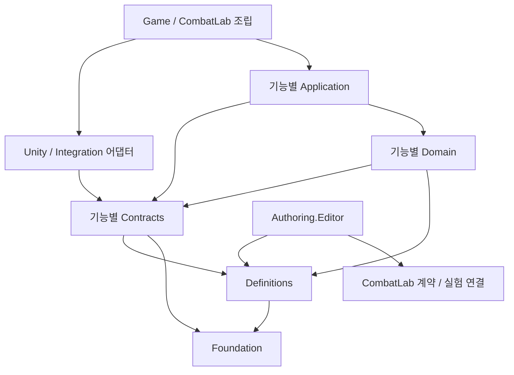

# 프로젝트 목표 구조와 모듈 계약

[분야 개요](README.md)

이 문서는 리팩토링 후의 **통합 구조 제안**이다. 현재 파일 배치나 구현 완료 상태를 뜻하지 않는다. 폴더·모듈 배치·계약의 기준은 이 문서에 모으고, 행동 시간표·실험 방식·맵 공급은 [게임플레이 설계](gameplay-architecture.md), 표현·대화·연출·GUI 동작은 [표현 설계](presentation-narrative-ui.md)를 따른다. 현 구현은 [현재 코드 구조](architecture.md)를 참고한다. 게임 규칙의 원본은 기존 기획 문서와 지정된 구조화 데이터다.

## 1. 조직 원칙

**기능별 모듈을 최상위에 두고, 각 모듈 내부에서 계약·규칙·실행 흐름·Unity 연결을 분리한다.** 폴더, 도메인, 어셈블리, GameObject를 일대일로 대응시키지 않는다.

- 도메인은 규칙과 상태를 소유하는 논리 경계다. 같은 전투에서 함께 변하는 이동·행동·판정은 `Combat` 내부의 하위 도메인으로 둔다.
- 모듈은 코드와 공개 계약의 소유 단위다. 외부는 공개 명령·조회·이벤트를 통해 접근한다.
- 레이어는 참조 방향과 책임을 나타낸다. 전체 프로젝트에 거대한 `Managers`·`Models`·`Views` 디렉터리를 만들지 않는다.
- 일반 C# 객체가 규칙과 상태를 소유한다. Unity 컴포넌트는 입력·충돌·렌더링·에셋·씬 수명을 연결한다.
- 처음부터 모든 디렉터리·인터페이스·asmdef를 만들지 않는다. 아래는 최종 배치 기준이며 실제 기능을 추출할 때 필요한 부분을 생성한다.

## 2. 저장소와 데이터 배치

```text
deviant/
├─ docs/
│  ├─ design/                         # 제품 규칙·미정 사항
│  ├─ development/                    # 현재 구현·목표 구조·개발 방법
│  └─ workflow/                       # 협업·에셋 제작 기준
├─ data/
│  ├─ combat/                         # 행동·이동·피해·전투 타이밍 원본
│  ├─ equipment/                      # 장비·잉크 정의의 이행 후 원본
│  ├─ world/                          # 챕터·고정 배치·생성 설정·모듈 참조
│  ├─ narrative/                      # NPC·대화·범위가 명시된 이야기 사실
│  ├─ sequences/                      # 연출 단계·바인딩·중단 정책
│  ├─ presentation/                   # 공통 Cue·카메라·음향 재생 설정
│  ├─ text/                           # 텍스트 키와 문구
│  └─ experiments/                    # 공유 시나리오·A/B 프리셋
├─ tools/
│  ├─ combat/                         # 현재 생성·검증·가져오기 도구
│  └─ content/                        # 목표 통합 검증·생성 진입점
├─ unity/
│  ├─ Assets/Deviant/                 # 아래의 기능별 코드·Unity 에셋
│  ├─ Packages/
│  └─ ProjectSettings/
├─ resources/                        # 고정 외부 리소스 저장소: 원본·도구·검증
│  └─ authoring/workbench/source/     # 공통 제작 도구·편집 데이터·미리보기
└─ outputs/                          # Git 제외: 로그·녹화·캡처·검증 산출물
```

`data/`의 추가 폴더는 목표다. 현재 `data/combat/` 원본을 즉시 나누거나 복제하지 않는다. 이행 시 콘텐츠 ID별 원본 매핑을 갱신하고 기존/신규 파일의 이중 정의를 거부한다. 전투 수치와 공격에 결합된 프레임 타이밍은 계속 `data/combat/`가 소유한다. 공통 Cue에 공격 판정 시각을 복사하지 않는다.

| 자료 | 편집 원본 | 실행/빌드 산출물 |
|---|---|---|
| 수치·대화·연출·논리 배치 | 지정된 `data/` 파일 | 검증·해석된 불변 카탈로그 |
| 프리팹 내부 구조·타일/충돌 기하·GUI 배치 | 담당 모듈의 Unity 제작 에셋 | 임포트/빌드 에셋과 추출 메타데이터 |
| 아트 제작 원본·공유 패키지 | 기존 제작 규칙에 지정된 위치 | 모듈 `Content/`의 게임용 에셋 |
| 프레임/프리팹/음향 참조 연결 | 담당 모듈의 Unity 바인딩 에셋 | 콘텐츠 ID→Unity 에셋 참조 |
| 실행 중 임시 실험 | 메모리 오버라이드 | 명시적으로 저장한 경우에만 원본/공유 프리셋 반영 |

고정 맵 배치 데이터는 제작 모듈을 ID로 참조한다. 프리팹 내부 기하를 JSON에 다시 수작업으로 복제하지 않고 검증용 메타데이터를 추출한다. 기존 직접 편집 씬은 이행 어댑터로 읽고, 새 저작 도구의 저장 경로를 확정하기 전에는 원본을 바꾸지 않는다.

`Generated/`는 생성 전용 경계다. Resources·직접 에셋 참조 등 실제 로딩 방식은 콘텐츠 공급 어댑터가 감춘다. Addressables 도입을 전제하지 않는다. 생성물의 추적 여부는 기존 파이프라인 정책을 이어가되 직접 편집은 금지한다.

## 3. Unity 최종 폴더 구조

```text
unity/Assets/Deviant/
├─ Foundation/                       # 작은 공통 값·수명 도구
├─ Definitions/                      # 불변 정의·스키마·시간표 해석
│  ├─ Runtime/
│  │  ├─ Combat/
│  │  ├─ Equipment/
│  │  ├─ World/
│  │  ├─ Narrative/
│  │  ├─ Sequences/
│  │  ├─ Presentation/
│  │  └─ Compilation/
│  └─ Tests/
├─ Combat/                           # 공통 전투
│  ├─ Contracts/
│  ├─ Runtime/
│  │  ├─ Domain/
│  │  │  ├─ Actors/
│  │  │  ├─ Locomotion/
│  │  │  ├─ Actions/
│  │  │  ├─ Hits/
│  │  │  ├─ Damage/
│  │  │  ├─ Statuses/
│  │  │  ├─ Effects/
│  │  │  └─ Recovery/
│  │  └─ Application/
│  │     ├─ Simulation/
│  │     ├─ Commands/
│  │     └─ AI/
│  ├─ Unity/                         # Motor·Physics2D·ActorView 연결
│  ├─ Content/                       # 전투 액터/효과 프리팹 등
│  └─ Tests/
├─ Equipment/                        # 장비·잉크·능력치·재고·정비
├─ World/                            # 레이아웃·공급·검증·상태·로딩
├─ Narrative/                        # 상호작용·NPC·대화·이야기 사실
├─ Sequences/                        # 연출 실행과 단계
├─ Run/                              # 런 수명·챕터 진행
├─ Input/                            # 장치 독립 액션·바인딩·장치 수명
├─ Control/                          # 소유자별 입력 제한·시간 제어 요청
├─ Presentation/                     # 모션·Cue·음향·카메라
├─ UI/                               # 화면·Presenter·uGUI View·위젯
├─ Integration/                      # 모듈 간 번역 어댑터·공통 연결
│  ├─ Runtime/
│  └─ Unity/
├─ Game/
│  ├─ Runtime/                       # 본 게임 진입·조립
│  ├─ Scenes/                        # 공통 게임 씬 등
│  ├─ Content/                       # 본 게임 구성 에셋
│  └─ Editor/                        # 본 게임 빌드 진입점
├─ CombatLab/
│  ├─ Runtime/                       # 시나리오·리셋·A/B·기록
│  ├─ Unity/                         # 실험 조립·디버그 표시
│  └─ Scenes/                        # 같은 전투를 사용하는 시험장
├─ Authoring/
│  └─ Editor/                        # 데이터 편집·미리보기·저장·가져오기
├─ Generated/                        # 생성 카탈로그·메타데이터
└─ Tests/
   ├─ Integration/                   # 여러 모듈의 연결 검사
   └─ Fixtures/                      # 공유 테스트 데이터
```

표시를 생략한 기능 모듈은 다음 형태 중 필요한 폴더만 사용한다.

```text
<Feature>/
├─ Contracts/                        # 명령·조회·이벤트·포트·공개 값
├─ Runtime/
│  ├─ Domain/                        # 상태·규칙·불변조건
│  └─ Application/                   # 유스케이스·실행기·조율
├─ Unity/                            # Unity 의존 어댑터
├─ Content/                          # Prefabs·Art·Audio·Bindings 등
├─ Editor/                           # 기능 전용 임포터 등, 필요할 때
└─ Tests/
   ├─ EditMode/
   └─ PlayMode/
```

`UI/Runtime`에는 화면별 Presenter·표시 모델과 Router를, `UI/Unity`에는 Canvas View·EventSystem 연결을 둔다. `Domain/`을 형식적으로 만들지 않는다. 여러 기능을 함께 편집하는 도구는 `Authoring/Editor`, 해당 기능만의 임포터는 모듈 `Editor`에 둔다.

`Foundation`에는 소유자 핸들·취소 수명 등 도메인 중립적인 최소 요소만 둔다. 게임 상태, 서비스 로케이터, 거대한 공통 Manager, 각 기능의 ID/규칙을 모으지 않는다. 콘텐츠 ID는 `Definitions`의 해당 영역, 실행 ID는 소유 모듈의 계약에 둔다.

## 4. 레이어와 참조 규칙

| 레이어 | 위치 | 책임 | 금지하는 의존 |
|---|---|---|---|
| 정의 | `Definitions` | 읽기 전용 콘텐츠와 검증/컴파일 | 실행 상태·씬·GUI |
| 공개 계약 | `<Feature>/Contracts` | 입출력 형태, 호출/수명 약속, 외부 기능 포트 | 구체 실행기·Unity 객체 |
| 도메인 | `<Feature>/Runtime/Domain` | 규칙과 변경 권한을 가진 상태 | MonoBehaviour·파일 IO·Canvas |
| 실행 흐름 | `<Feature>/Runtime/Application` | 명령 처리, 스케줄링, 세션 진행 | Unity 구현체·외부 모듈의 내부 상태 |
| 어댑터 | `<Feature>/Unity`, `Integration` | 물리·입력·에셋·UI·모듈 간 변환 | 다른 모듈 상태를 우회 수정 |
| 조립 | `Game`, `CombatLab` | 생성, 주입, 시작·종료 순서 | 전투/진행 규칙의 중복 구현 |
| 저작 | `Authoring/Editor` | 원본 편집·검증·생성·미리보기 | 일반 플레이어 빌드에 포함 |

현재 GameComposition/LabComposition은 같은 CombatArena.Initialize에 콘텐츠·프로필·환경·입력·표현을 명시적으로 공급한다. Game 소유 기술 진단 View는 두 루트가 사용하지만 시험장 생성/캡처/추적은 조건부 CombatLab.Unity에만 두고 일반 제품에서 제외한다. 이 조립 경계는 정식 Run/챕터 정책이나 모든 Native 물리의 순수 이행 완료를 뜻하지 않는다.



화살표는 컴파일 참조 방향이다. Application은 자신이 소유한 포트를 호출하고 Unity/Integration 어댑터가 구현한다. 런타임 호출 결과가 안쪽으로 돌아오는 것이 역방향 컴파일 의존을 뜻하지 않는다.

서로 다른 모듈의 내부 구현을 직접 참조하지 않는다. 필요한 공개 계약은 사용할 수 있지만 계약 어셈블리끼리 순환 참조를 만들지 않는다. 서로 다른 모델을 번역해야 한다면 소비 모듈이 필요한 형태의 포트를 정의하고 `Integration`이 양쪽 계약을 연결한다. 예를 들어 대화는 전투·장비 구현을 몰라도 조건 조회와 명령 결과를 받을 수 있다.

초기에는 순수 코드/Unity/Editor/테스트 경계를 먼저 asmdef로 강제한다. 이후 공개 경계가 안정된 기능에 `Deviant.<Feature>.Contracts`, `Deviant.<Feature>`, `Deviant.<Feature>.Unity`를 적용한다. 필요 없는 어셈블리를 빈 채로 만들지 않는다. 순수 어셈블리는 UnityEngine 참조를 금지하고 Editor 전용 코드는 Editor 대상으로 제한한다. 제품 빌드 구성은 `CombatLab`·저작 도구를 포함하지 않도록 별도 검증한다.

## 5. 도메인·주요 객체·소유권

| 모듈 | 하위 도메인/기능 | 주요 객체 | 변경 권한 |
|---|---|---|---|
| Combat | 액터·이동·행동·판정·피해·상태·효과·복귀 | `ActorState`, `ActionExecution`, `CombatEffectState`, `CombatSimulation`, `ActionArbiter`, `MotionResolver` | HP·행동·액터 운동·타격 결과 |
| Equipment | 장비·잉크·스탯·쿨타임·충전·재고·정비 | `WeaponInstance`, `Loadout`, `StatResolver`, `ChargePool`, `InventoryState` | 무기별 슬롯/자원과 재고. 재고 기능은 후속 범위 |
| World | 레이아웃·검증·배치·챕터 상태·로딩 계획 | `ChapterLayout`, `LayoutValidator`, `ChapterState`, `StreamingPlanner` | 배치 식별과 월드 상태. 진행 조건은 Run에 위임 |
| Narrative | 상호작용·NPC·대화·이야기 사실 | `InteractionSession`, `DialogueSession`, `NarrativeState` | 대화 진행과 명시된 범위의 이야기 사실 |
| Sequences | 연출 실행·단계·바인딩 | `SequenceExecution`, `SequenceRunner` | 연출 진행 상태. 실제 게임 변경은 명령 요청 |
| Run | 런 수명·챕터 전환 흐름 | `RunSession`, `ChapterSession`, `RunFlow` | 런/챕터 시작·종료. 전환 조건·경제는 후속 기획 |
| Input | 의미 기반 액션·장치별 바인딩·이벤트 수명 | `IGameInput`, `GameInputEvent`, `InputActionSource` | 물리 장치와 게임 의도의 분리. 전투 변환은 Integration이 소유 |
| Control | 입력 제한·시계 정책 | `InputPolicy`, `TimePolicy`, `ControlLease` | 소유자 요청의 합성과 해제 |
| Presentation | 모션·Cue·카메라·오디오 | `SpritePresenter`, `CuePlayer`, `CameraDirector`, `PlaybackHandle` | 시각·청각 상태만 |
| UI | 화면·위젯·포커스 | `ScreenRouter`, 화면별 `Presenter`, `ViewModel`, `View` | 창·포커스·표시 상태만 |
| CombatLab | 시나리오·실험 오버라이드·기록 | `ExperimentSession`, `ScenarioRunner`, `InputRecorder` | 격리된 실험 세션과 프리셋 |

`CombatSimulation`은 매 tick 실행 순서를 관리하며 모든 규칙을 직접 갖지 않는다. `ActionArbiter`는 무엇을 시작/취소할지 결정하고 `ActionRunner`는 시작된 시간표를 실행한다. AI는 같은 명령 경로에 입력 의도를 제공한다.

`CombatTickSnapshot`은 Combat Application의 단계 전용 일시 참조 저장소이고 액터 소속·전투 상태·시계의 추가 원본이 아니다. Unity 틱 어댑터 한 개가 소유하며 실행기의 기존 직렬 실행 경계 안에서만 재사용한다.

장비 자원은 무기 인스턴스가 소유한다. Combat은 `IActionResources` 포트로 실제 발동 시 소비를 요청하고 발동 스탯 스냅샷을 받는다. `Integration`이 Equipment 계약에 연결하며 Combat이 쿨타임 복사본을 따로 갖지 않는다. 비활성 무기의 자원 갱신도 같은 시뮬레이션 시간으로 진행한다. 액터 고유 대시/점프 자원은 Combat이 소유한다.

World의 기록은 액터 HP의 두 번째 실시간 원본이 아니다. 활성 액터 HP는 Combat이 소유하고, World는 사망 같은 확정 사실과 명시적 비활성화 시 이전받은 상태를 보관한다. 재활성화에서만 상태를 인계하며 원본 소유자가 동시에 둘이 되지 않게 한다. 구체적인 재등장 정책은 미정이다.

### 객체 수명

```text
ApplicationScope
├─ 콘텐츠 스냅샷·설정·에셋 공급·공통 제어 서비스
└─ RunScope 또는 ExperimentScope
   ├─ RunSession 또는 ExperimentSession
   ├─ 장비 인스턴스·해당 범위의 이야기 상태
   └─ ChapterScope
      ├─ ChapterLayout + ChapterState
      ├─ CombatSimulation
      │  ├─ ActorState → 현재 ActionExecution
      │  └─ CombatEffectState[]       # 행동 취소 후에도 독립 수명 가능
      ├─ DialogueSession / SequenceExecution
      └─ 로드된 청크·ActorView·Cue·GUI 연결
```

애플리케이션 UI가 모두 챕터에 속하는 것은 아니다. 화면마다 소유 범위를 지정한다. 소유 범위 종료는 새 명령 차단 → 자식 실행 취소 → 제어/구독/재생 핸들 반환 → 뷰 해제 순서로 조율한다. 사망·리셋·런 종료에 적용할 실제 정리 규칙은 기존 명세를 보존한다. 청크 언로드가 챕터 상태 종료나 보상 재생성을 뜻하지 않는다.

### GameObject와 도메인 객체의 관계

`ActorView` GameObject에는 위치/콜라이더 동기화 어댑터, 스프라이트 표현, Actor ID 바인딩이 붙는다. HP·행동·쿨타임의 원본은 일반 C# 상태에 있다. 스프라이트만 있는 시각 효과에는 피해 처리기를 붙이지 않는다. NPC 뷰와 대화창도 각각 배치 ID·세션 ID에 연결될 뿐 대화 진행 사실을 소유하지 않는다.

활성 Combat 액터의 현재 X/Y·속도·방향·접촉 사실은 ActorKinematicsState 한 순수 원본에 있다. 모터와 명시적 텔레포트/귀환/리셋 포즈 명령은 같은 동기 Unity 출력 바인딩을 사용한다. Transform은 출력이지 별도 가변 전투 원본이 아니며 Native Z는 2D 상태 밖에 둔다. 뷰 별칭도 위치 소유권을 우회하지 않고 읽기 스냅샷은 살아 있는 참조를 포함하지 않는다.

같은 객체를 씬에 새로 만들거나 풀에서 재사용해도 세대 ID가 달라진다. 오래된 비동기 응답은 ID와 세대를 검증해 폐기한다. Unity InstanceID나 배열 순서를 저장/재현 식별자로 사용하지 않는다.

## 6. 모듈 간 계약

계약은 인터페이스 선언뿐 아니라 **입력·결과·오류·시간·소유권·중복 처리 규칙**을 포함한다. 아래는 목표 계약 전체이며, 현재 구현된 이름과 지원 범위는 [현재 코드 구조](architecture.md)에서 구분한다.

현재 CombatReadModel 계약은 엔진/실행 구현을 참조하지 않는 불변 값과 문자열만 제공한다. CombatArena.ReadModel은 현재 Player/enemies/decoys의 실제 소속·참조를 해석하고 각 상태 원본을 필요한 때 조회한다. GameComposition/BattleHudDataSource는 초기화/리셋에 명시적으로 재바인딩하며 순수 계약에 Native 액터를 노출하지 않는다. 실험 지표는 성공한 공통 틱 뒤 HP·유효 수신 수·포즈를 조회한다. 이 읽기 경계는 AI 명령·행동별 결과·확정 이벤트 집계 완료를 뜻하지 않는다.

현재 ICombatCommands의 플레이어 경로는 기존 입력 세션/순서를 재사용하고 AI는 명시 actor-local 순번과 실제 resolver 결과를 사용한다. 실제 행동 결과는 1024개 ring에 단조 event 순번으로 남고 소비자는 자기 cursor/버퍼로 조회하며 유실 수를 확인한다. reset은 세션 재바인딩을 요구한다. 읽기 모델 단독 계약과 달리 이 경계는 실제 명령 결과를 제공하지만 제품 전역 이벤트/저장 버스는 아니다.

ICombatHitEvents는 Unity 객체 없는 불변 값과 caller-buffer polling을 사용한다. arena의 2048개 ring과 독립 cursor/유실 수로 수락 타격을 조회하며 observer가 피해 경로에 재진입하지 않는다. 원래 발사/타격 identity는 Native 어댑터가 명시 전달하고 이미 생성된 독립 효과는 원래 provenance를 유지한다.

ActorReadSnapshot.Presentation의 축/기본 타수/대시 길이·행동/접근·접촉/본체 길이·동적 매핑 값은 Unity 없는 불변 조회다. Sprite/매체/Renderer 핸들은 CharacterPresentationBinding이 초기화/리셋 때 명시 바인딩하고 arena 종료에 정리한다. 뷰/캐스트 참조를 순수 snapshot에 넣거나 Draw 중 새 액터로 자동 재지정하지 않는다.

MotionSourceRegistry는 기존 제공 매체 팔레트/clip source와 전체 typed 행동/변환 바인딩을 불변 그래프로 검증한다. 시작 MotionActionKey와 명시 캡처 바인딩이 UI/Draw의 live 무기 조회를 막는다. 공유 media source와 행동 게임플레이 시간은 소유권을 구분하며 고정 시간 비중 저작을 모든 정책의 FrameTime 재시간화 완료로 표현하지 않는다.

MeleeFrameCatalog는 20개 행동의 명시 상속/override를 소유하고 registry의 독립 BindingHash를 가족 전체 hash에 결합한다. registry 자체가 전투 가족 catalog를 참조해 새 시간 권한을 갖지 않는다. Source projection과 applied snapshot은 각각 canonical 상속·현재 버전 고정이라는 다른 계약이다.

| 계약 | 선언 소유자 → 구현/제공자 | 핵심 약속 |
|---|---|---|
| `ICombatCommands` | Combat → Combat Application | 명령 수집과 실제 실행 결과 구분. 액터/세션·명령 순번 검사. tick에서 자원·우선순위 재검사 |
| `ICombatReadModel` / 전투 이벤트 | Combat → Combat Application | 읽기 전용 상태와 확정 이벤트. 외부에 가변 ActorState 노출 금지 |
| `IWorldQuery` / `ICharacterMotor` | Combat → Combat.Unity | 순수 좌표·기하로 질의/이동 요청, 접촉·실제 이동 결과 반환. Unity 콜라이더 객체를 계약으로 노출하지 않음 |
| `IActionResources` | Combat → Integration → Equipment | 발동 시 자원 검사/소비와 스탯 스냅샷. 중복 발동 요청은 동일 결과, 실패는 소비 없음 |
| `IEquipmentCommands` / 조회 | Equipment → Equipment Application | 슬롯·재고·정비 조건 검사. 교환 실패 시 부분 이동 금지 |
| `IChapterLayoutProvider` | World → 고정/절차 공급기 | 버전·입력에 대응한 불변 레이아웃 또는 실패. 활성 씬 변경 없음 |
| `IChapterViewLoader` | World → World.Unity | 로드 요청에 대한 핸들/결과. 취소/언로드가 진행 상태를 초기화하지 않음 |
| `IDialogueCommands` / 조회 | Narrative → Narrative Application | 현재 세션·노드·선택지 검증, 조건 재검사, 완료/취소/실패 구분 |
| `INarrativeContext` / 명시적 명령 포트 | Narrative → Integration | 필요한 사실만 조회, 허용된 타입의 변경만 요청. 임의 코드/전역 변수 접근 없음 |
| `ISequenceBindings` | Sequences → Integration | 대화·Cue·액터·카메라 단계에 실행 핸들 제공. 필수 앵커 검증, 취소·실패 전달 |
| `ICuePlayer` / `ICameraRequests` | Presentation → Presentation.Unity | 소유자·앵커·시계가 있는 재생/구도 핸들. 중복 정리 가능, 게임 규칙 부작용 없음 |
| `IControlRequests` | Control → Control Runtime | 소유자별 입력/시간 요청. 해당 핸들만 해제, 남은 요청 합성 유지 |
| 화면별 View 계약 | UI → UI.Unity | 표시 모델 적용과 사용자 의도 전달. 닫힘/재바인딩 후 오래된 입력 거부 |
| 콘텐츠 공급/저장 포트 | 소비 모듈 → Unity/Integration 어댑터 | 버전 명시·실패 결과·취소 수명. 저장 항목은 승인된 스키마만 사용 |

물리적 위치는 Motor 경로에서만 변경한다. Domain의 이동 계산 결과와 Unity 접촉 결과를 한 번 확정한 뒤 뷰에 반영한다. 전투와 카메라가 각각 Transform을 이동시키지 않는다. 지형 정보의 공급 방식은 Motor가 알 필요가 없다.

명령이 큐에 접수된 것은 성공적으로 실행됐다는 뜻이 아니다. 실행 결과는 `Succeeded / Rejected / Cancelled / Failed`와 이유로 구분하고, 즉시 끝나는 동기 명령은 즉시 결과를 반환한다. 모든 요청을 Task나 전역 메시지 큐로 만드는 것은 아니다.

지연·중복 가능성이 있는 요청은 실행 키를 사용한다. 실행 핸들은 완료 결과·취소·소유 범위를 갖는다. 중복 제거 기록은 해당 세션 수명에 묶고 무한히 축적하지 않는다. 확정 이벤트에는 이벤트 순번·논리 시각·소유자/실행 ID·필요한 값 스냅샷을 포함한다. 이벤트 핸들러는 새 명령을 정해진 경계에 요청하며 판정 도중 상태를 재진입 수정하지 않는다.

현재 플레이어 입력은 CombatInputIngress가 actor/session·generation/epoch·순번 검사와 개별 press/release/continuous 표본·동일 tick bit-union 투영을 소유한다. Admitted(접수), Consumed(중재 경계), 전체 tick Completed/Faulted, 개별 행동 성공은 서로 다르다. 키보드는 실제 이벤트 순서와 `Realtime` 시각을 값 복사한 뒤 기존 Update에서 접수하며 같은 이벤트 안의 동시 키만 안정 순서를 사용한다. 장치 시각은 관측 메타데이터이며 전투 시계를 대체하지 않는다. 일반 reset도 옛 토큰을 무효화하며 NewEpoch만 시계/연속 입력을 다시 시작한다. 실험 관측은 preallocated bounded ring을 poll하며 이벤트 콜백/관측자로 판정 중 재진입하지 않는다. overflow 유실 수를 게임플레이 입력 재실행이나 행동 성공으로 해석하지 않는다. 실제 행동 결과와 확정 타격은 별도 명령/타격 계약을 사용한다.

화면의 HP처럼 지속 정보는 조회 모델로 복구하고, 타격음처럼 일회성인 정보는 이벤트로 처리한다. 무기 정의와 진행 중 공격은 시작한 콘텐츠 버전을 참조하며, 독립 효과는 발동 스탯을 보존한다.

## 7. 세 가지 대표 흐름

### 공격과 실험

```text
키보드/패드·AI·기록 입력
 → ICombatCommands
 → ActionArbiter → ActionRunner
 → IActionResources (실제 발동 시)
 → MotionResolver → Motor → HitDetection → DamageResolver
 → 읽기 모델 + 확정 이벤트
 → SpritePresenter / CuePlayer / HUD
```

Editor는 원본 후보를 검증·컴파일해 새 스냅샷을 만든다. 실험장은 다음 실행부터 적용하거나 동일 시나리오를 리셋한다. 스프라이트·판정·이동은 같은 시간표를 읽고 생성된 효과는 자신의 버전을 유지한다. 원본 저장은 별도 명시적 동작이다.

### 고정/생성 맵

```text
챕터 요청
 → IChapterLayoutProvider (고정 또는 절차)
 → ChapterLayout → 공통 검증
 → ChapterState + WorldAssembler/Streaming
 → 동일한 Combat / Narrative / Presentation
```

A/B에서는 레이아웃 스냅샷을 고정한다. 콘텐츠 구역과 청크를 구분하고, NPC/연출은 배치 ID와 앵커로 바인딩한다. 실제 생성 알고리즘·맵 재생성 시점은 미정이다.

### NPC 대화와 연출·GUI

```text
상호작용 명령 → Interaction → DialogueSession
 → 표시 모델 → DialoguePresenter → uGUI View
 → 선택 명령 → 세션/조건 재검사
 → 필요 시 담당 도메인 명령
 → SequenceRunner → Cue / Camera / Fade
 → 완료·취소 결과 + 소유 제어 반환
```

대화·연출·일시정지의 입력/시간 요청은 각각 소유자를 가진다. 일시정지 창을 닫아도 대화가 보유한 제한은 남는다. 스킵은 선언된 종료 계약을 실행하고 취소는 남은 실행을 정리한다. GUI가 도메인 상태를 직접 바꾸지 않는다.

## 8. 기존 코드의 목표 위치

| 현재 코드/영역 | 목표 배치 |
|---|---|
| `CombatCore` | Definitions의 데이터, Combat의 규칙/예약/복귀, Equipment의 능력치/무기 자원으로 분리 |
| `CombatPlayer` | Combat의 명령·행동 중재·이동·복귀, Unity 입력은 외부 어댑터 |
| `CombatActor` | Combat ActorState·Damage·Status와 Combat.Unity Motor/View 연결 |
| `CombatCast`·partial | Combat Actions·개별 실행 정책·Effects |
| `CombatArena` | CombatSimulation, 물리 어댑터, CombatLab 시나리오/디버그, Game/Lab 조립으로 분리 |
| `CharacterAnimationV2` / `CharacterPresenter` | Definitions의 타이밍 자료와 Presentation 모션/Cue 재생 |
| `TestEnemy` | Combat Application의 AI 의도 생성과 기존 공통 행동 경로 |
| `InkForestWorld` / `InkForestData` | World의 레이아웃 공급·상태·구성과 스트리밍 어댑터 |
| `InkForestCamera` | Presentation 카메라 구현과 World의 카메라 영역 바인딩 |
| `BattleHudView` | UI Presenter/View와 Control 요청 어댑터 |
| `GameComposition` | Game 조립과 Integration의 모듈 연결 |
| `Weapons` 표현 라이브러리 | Presentation 바인딩/Content. 실제 무기 상태는 Equipment |
| 기존 임포터·생성기 | 기능 Editor 또는 Authoring, 기존 CLI는 전환 진입점으로 유지 |

`Gameplay.Unity`라는 이전 논리 영역은 Combat/World/Control 등의 `Unity/`와 `Integration`에 배치한다. `Interaction`·`Dialogue`·`NarrativeState`는 `Narrative`의 하위 책임이다. `WorldStreaming`의 로드 계획과 실제 Unity 로딩을 구분한다. 폴더명 정규화로 별도 플레이어·전투·대화 구현을 만들지 않는다.

## 9. 이행·검증 기준

실제 이행 순서는 [게임플레이 이행 단계](gameplay-architecture.md#10-이행-순서와-완료-조건)를 따른다. 목표 트리를 만들기 위해 먼저 전체 파일을 옮기지 않는다. 첫 실험 루프를 유지하면서 책임 추출 → 계약 검사 → 호출부 전환 → 참조 확인 → 기존 코드 제거 순서로 진행한다. 파일 이동과 동작 변경을 분리하고 `.meta` GUID·씬·프리팹 참조를 보존한다.

- 어셈블리 참조 검사: 순수 코드의 UnityEngine 의존, 기능 간 내부 구현 참조, 순환 의존, 제품의 CombatLab/Editor 참조를 검출.
- 계약 검사: 명령 접수/실행 구분, 실패 시 상태 보존, 중복 소비/실행 방지, 읽기 모델 불변성, 취소/완료 핸들 수명.
- 시뮬레이션/물리 검사: 기존 판정·취소·자원·점프·대시·효과 수명과 실제 접촉 결과 보존.
- 콘텐츠 검사: 단일 편집 원본, ID/참조/버전 검증, Editor 미리보기와 빌드 카탈로그의 동일 해석.
- 통합 검사: 본 게임/실험장의 공통 런타임, 고정/생성 결과 공통 실행, 대화/연출/GUI의 중첩 제어와 씬 전환 정리.

이는 목표 검증 계약이다. 문서 작성이나 폴더 생성만으로 코드 이행·Unity 컴파일·플레이 검증을 완료했다고 하지 않는다.
