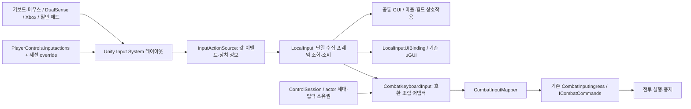

# 다중 입력 장치 구조와 조작

[분야 개요](README.md)

키보드·마우스, DualSense, Xbox 패드, Unity가 `Gamepad`로 인식하는 일반 패드는 같은 게임 액션을 사용한다. 물리 배치의 편집 원본은 [`PlayerControls.inputactions`](../../../../unity/Assets/Deviant/Input/Resources/Input/PlayerControls.inputactions)다. 전투 규칙은 [전투 명세](../../../design/combat/rules.md), 화면 동작은 [UI·상호작용](../../../design/ui/ui-and-interaction.md)을 따른다.

## 현재 연결 범위

현재 입력 조립은 타이틀 → 시작 마을 → 챕터 1 → 챕터 2와 공통 전투/시험장의 입력 컴포넌트에 연결돼 있다. 이동·벽타기·점프·발판 내려가기·대시·두 슬롯의 기본/스킬·상호작용·포탈, 봉인 석판·웨이브 클리어 보상 상자·잠긴 상자, 마을 오프닝/대화, 제품 공통 GUI의 탐색·확인·취소·가방·지도·일시정지를 지원한다. 전투 ingress·리플레이 계약을 유지한다.

HUD·월드 키캡, 시스템 안내, 마을 출발 알림, 가방·지도·정비소, 포탈 설명 대사는 실제 바인딩과 마지막 사용 장치에 따라 키/버튼 이름을 바꾼다. 텍스트는 `{Interact}`·`{Jump}`·`{Advance}`·`{CheckpointInstall}` 같은 액션 토큰과 `{Move.Up}`·`{Move.Down}` 같은 방향 토큰을 사용하며, `LocalInput.FormatPrompt`가 표시 시점에 해석한다. 키보드 재설정도 같은 경로로 반영한다. 튜토리얼 카드·상단 배너·유령 시범의 키캡은 열린 상태에서도 장치 변경을 반영하며 시범·확인 대기·완료 시간을 다시 시작하지 않는다. 키보드에만 배정된 개발 단축키는 패드 버튼을 추측하지 않고 키보드 단축키로 표시한다. 새 버튼 그림을 생성하거나 리소스 원본을 변경하지 않고 기존 UI와 텍스트를 사용한다.

지원되지 않는 HID의 자동 버튼 추측, 게임패드 바인딩 재설정, 개발 IMGUI 패널의 패드 탐색과 LED 출력은 후속 범위다. 공통 전투에는 이벤트 진동과 DualSense 적응형 트리거 출력을 연결한다. 바인딩 오버라이드 API와 출력 지원 범위는 아래와 같다. 합성 장치 검사는 실물 USB/BT 조작·촉감·최종 화면 가독성의 승인을 뜻하지 않는다.

## 기본 조작

아래 버튼은 위치 기반의 공통 `<Gamepad>` control에 바인딩한다. DualSense·Xbox별 전투 코드를 만들지 않는다. DualShock 계열 패드도 같은 위치 기반 입력을 사용할 수 있다. 사용자 제공 대표작 비교의 A 점프·X/Y 공격·B 대시·LT/RT 스킬·RB 상호작용을 기본으로 두며, 이 게임의 두 무기 기본 공격을 X/Y에 각각 연결하고 가방은 LB에 둔다.

| 게임 동작 | 키보드·마우스 | Xbox / 일반 Gamepad | DualSense |
|---|---|---|---|
| 이동·벽 오르기·아래 방향 | ←/→, ↑, ↓ | 왼쪽 스틱 / 십자키 | 왼쪽 스틱 / 십자키 |
| 점프·아래+점프 | Space | A | Cross |
| 대시 | 좌/우 Shift | B | Circle |
| 무기 1 / 2 기본 | A / S | X / Y | Square / Triangle |
| 무기 1 / 2 스킬 | Q / W | LT / RT | L2 / R2 |
| 무기 1·2 순서 교환 | X | 오른쪽 스틱 왼쪽 | 오른쪽 스틱 왼쪽 |
| 받아 둔 보상 열기 | G | 오른쪽 스틱 위 | 오른쪽 스틱 위 |
| 보상 리롤 | R | X | Square |
| 인벤토리 잉크 칸 비우기 / 장비 해제 | R | X | Square |
| 인벤토리 무기 이름 변경 | N | Y | Triangle |
| 제작 완료 후 보관 | C 또는 Esc | B | Circle |
| 인벤토리 설명 스크롤 | W / S | 오른쪽 스틱 상하 | 오른쪽 스틱 상하 |
| 월드 상호작용 | F | RB | R1 |
| 가방 | Tab | LB | L1 |
| 전체 지도 | M | View | Create (DualShock은 Share) |
| 일시정지 / 오프닝 길게 눌러 건너뛰기 | Esc | Menu | Options |
| UI 탐색·확인·취소 | 방향키·F·Esc (타이틀은 기존 Enter) | 스틱/십자키·A·B | 스틱/십자키·Cross·Circle |
| 대화·노트 진행 | Space / Enter / F | A 또는 RB | Cross 또는 R1 |
| 인벤토리 선택·제작·장착 | F | A | Cross |
| 지도 이동·확대·축소 | 드래그·휠·+/− | 오른쪽 스틱·RB/LB | 오른쪽 스틱·R1/L1 |
| 지도 현재 위치·탐험한 범위 보기 | C / Home | X / Y | Square / Triangle |
| 포탈1·포탈2 설치(건너가기는 상호작용) | C / V | L3 / R3 | L3 / R3 |
| 조작 안내 표시 | H 또는 메뉴 항목 | 메뉴 항목 | 메뉴 항목 |
| 허수아비 훈련 표적 회복 | F5(단축키 화면에서 바꾸지 않음) | 기본 배정 없음 | 기본 배정 없음 |

**B/Circle은 게임 진행 중 대시이며, 열린 화면에서만 취소로 소비한다.** 봉인 도전의 증강 보상은 카드 이동→South로 선택→아래의 획득 버튼을 South로 확인하는 순서이며, 취소로 닫거나 가방·지도를 겹쳐 열지 않는다. Menu/Options는 화면이 없어도 일시정지를 연다. 같은 Esc가 Pause와 Cancel 두 액션에 들어가더라도 한 번만 처리한다. 메뉴를 닫은 A/B가 그 프레임의 점프/대시로 이어지지 않는다.

Web Player는 [전체화면 Escape 처리](../../delivery/web-build.md#전체화면과-escape)로 지원 브라우저에서 Keyboard Lock 권한을 요청한다. 허용되면 짧은 ESC는 기존 Pause/Cancel로 전달되고, 길게 누르는 브라우저 종료 동작은 유지된다. 입력 바인딩 자체는 바꾸지 않는다. 미지원/권한 거부 환경은 기존 동작과 HUD Pause 버튼을 사용한다.

스킬의 누름·유지·해제는 슬롯별로 독립이며 기존 충전·예약·재입력 규칙을 따른다. 양쪽 장치에서 같은 스킬을 함께 누르면 하나를 놓아도 다른 입력이 유지되는 동안 액션 유지가 남는다. 아날로그 스틱은 Input System deadzone을 거친 뒤 기존 정수 `Axis`/`ClimbAxis`로 변환한다. 기본 변환 임계값은 0.5이며 이동 속도를 아날로그 비례 규칙으로 변경하지 않는다.

현재 승인 테마 메뉴의 키는 전투 재바인딩과 분리한다. 방향키·F·Esc·Q/E 탭·W/S 설명 스크롤은 고정이다. 가방·제작·장비·상점은 십자키/왼쪽 스틱 선택, South 확정, East/Start 뒤로, 어깨 버튼 탭, 오른쪽 스틱 설명 스크롤을 사용한다. 해당 화면의 입력은 한 프레임에 한 번만 처리하며 F/취소가 뒤 화면이나 전투에 다시 전달되지 않는다. 왼쪽 어깨 버튼의 탭 전환은 가방 열기/닫기 입력으로 다시 처리하지 않으며, 키보드 Tab은 가방을 닫는다. 화면 설정 유지 확인창은 키보드 F/Esc로 되돌리기·G로 유지, 패드 South로 유지·East/Start로 되돌리기를 사용한다.

## 키보드 단축키 변경

타이틀 또는 시작 마을과 챕터 1·2의 일시정지 메뉴에서 **설정 → 조작**을 연다. 설정창 오른쪽의 단일 스크롤 목록에 이동·전투·탐험·메뉴·지도·기타 동작을 표시한다. 기존 **단축키** 진입점도 같은 조작 탭을 연다. 메뉴 탐색·확인·뒤로는 변경할 수 없으며, 동작에 기본 키가 여러 개 있으면 키마다 변경할 수 있다. 변경할 키 버튼을 선택하고 새 키를 누른다. 대기 중 **입력 취소** 또는 Esc는 키 변경만 취소하고 설정창을 유지한다. 설정창을 닫으면 원래 타이틀 또는 일시정지 메뉴로 돌아간다.

같은 상황에서 쓰이는 동작에 이미 지정된 키는 거절하고 해당 동작을 안내한다. 별도 화면의 동작은 키를 공유할 수 있다. 예를 들어 점프와 대화 진행은 Space를, 일시정지와 메뉴 뒤로는 Esc를 공유한다. **기본 키로 복원** 또는 G로 확인창을 열고 G·복원으로 전체 키보드 배치를 되돌린다. F·Esc·취소는 기존 키를 유지한다. 복원·미적용 화면 설정 확인창에서 패드는 좌우 선택 후 South로 확정하고 East/Start로 취소한다. 키보드 오버라이드는 로컬 PlayerPrefs에 즉시 저장하고 다음 씬과 실행에서 기본 입력 프로필에 다시 적용한다. 마우스와 게임패드 조작은 기본 프로필의 배치를 사용한다.

보상 열기는 플레이 중에만 소비한다. 인벤토리·지도·일시정지·다른 보상·입력 차단 중에는 오른쪽 스틱 위로 새 보상을 열지 않는다. 보상 리롤과 인벤토리 해제는 같은 패드 버튼을 별도 화면에서 사용한다. 무기 교환은 인벤토리 설명 스크롤과 겹치지 않도록 오른쪽 스틱 왼쪽에 둔다. 오른쪽 스틱 클릭의 포탈 배치는 유지한다. 인벤토리의 패드 탭 전환은 LB/RB 또는 L1/R1이며, 키보드는 상위 탭 방향키 탐색을 사용한다. 이름 변경창은 패드로 열기·확인·취소할 수 있고 이름 입력에는 키보드가 필요하다.

인벤토리 본문·동작 키캡·닫기·하단 안내는 열린 상태에서도 장치와 바인딩 변경을 반영한다. 키보드의 고정 메뉴 F/Esc 안내는 실제 메뉴 입력과 일치시키고, 패드는 Submit/Cancel의 장치별 이름을 표시한다. 보상 화면의 선택·획득·가방·취소·리롤과 HUD 보상 키캡도 같은 장치 안내를 사용한다. 한 글자용 도트 게이지 키캡으로 표시할 수 없는 버튼 이름은 게이지 옆 텍스트 키캡으로 표시한다.

## 책임과 참조 방향



| 모듈 | 위치·어셈블리 | 책임 |
|---|---|---|
| 입력 계약 | `Input/Contracts`, `Deviant.Input.Contracts` | 의미 기반 `GameAction`, 컨텍스트, 값 이벤트·장치 표시 정보, `IGameInput`. Unity·Combat 비의존 |
| Unity 입력 | `Input/Unity`, `Deviant.Input.Unity` | 네이티브 에셋 사본·이벤트 큐·장치 지정·포커스·컨텍스트 무효화, `LocalInput`과 명시 uGUI 연결 |
| 전투 번역 | `Integration/Runtime/Input`, `Deviant.Integration.Input` | 일반 액션 → 기존 `CombatInput`/`CombatInputSample`. Unity·Input System 비의존 |
| 전투 Unity 어댑터 | 기존 `Combat/Runtime/Unity/CombatKeyboardInput` | 소스와 변환기 조립·actor/권한 검사·batch 용량 검사·최종 접수. 이름은 씬/편집 도구의 호환 경계 |
| 월드/UI 연결 | `PlayerControls`, 기존 월드 기능·`TemporaryGameGui` | 현재 소유권의 액션을 한 번 소비하고 기존 도메인 명령 호출 |
| 제어 | 기존 `ControlSession` | 소유자별 입력 제한·정지 합성. 물리 버튼 배치를 소유하지 않음 |

전투 어댑터는 Input.Unity와 순수 Integration.Input 변환기를 조립한다. Input은 Combat을 참조하지 않으며 순수 전투 계약과 중재 규칙에 장치 타입을 넣지 않는다. Game/Lab/Forest/Chapter2의 기존 `BindPlayerInput` 연결과 `CombatKeyboardInput.Bindings`, `ResetKeyEnabled`를 사용하는 도구는 계속 동작한다. 바뀐 레거시 키 필드만 다음 Input System 갱신 전에 해당 세션의 네이티브 binding override로 반영한다. 신규 배치의 원본은 `.inputactions`다.

전투 시뮬레이션이 실패 상태(`SimulationFaulted`)이면 전투 어댑터의 게임 입력 권한을 무효화하고 기존 대기 입력을 정리한다. 실패로 소비되지 않는 입력 큐에 새 장치 입력을 쌓지 않는다. 기존 전투 초기화가 성공하면 새 입력 세션에서 정상 접수를 재개한다. `DeviceInputIntegrationTests.FaultedSimulationDoesNotFillInputQueueAndResetAllowsInputAgain`은 실제 스텝 실패 뒤 1,100회 장치 갱신에서 새 샘플 접수 차단과 초기화 후 재개를 검사한다.

## 액션·컨텍스트·바인딩

`GameInputActions.Path(id)`의 `컨텍스트/액션` 이름으로 네이티브 액션을 연결한다. 필요한 액션의 부분집합을 가진 타이틀/실험 프로필을 공급할 수 있다. 제공한 액션은 타입과 의미를 검사한다.

| 컨텍스트 | 액션 |
|---|---|
| `Gameplay` | `Move`, `Weapon1Basic`, `Weapon2Basic`, `Weapon1Special`, `Weapon2Special`, `Dash`, `Jump`, `SwapWeaponOrder` |
| `World` | `Interact`, `CheckpointInstall`, `CheckpointReturn` |
| `UI` | `Navigate`, `Submit`, `Cancel`, `Point`, `Click`, `Scroll`, `Advance`, `Equip`, `MapPan`, `MapZoomIn/Out`, `MapFocus`, `MapFit`, `RerollReward`, `InventoryRemove`, `InventoryRename` |
| `Shortcuts` | `Pause`, `Inventory`, `Map`, `Help`, `OpenReward` |
| `Debug` | `DevelopmentReset`. Editor/Development 조건과 씬의 리셋 정책이 허용할 때만 활성화 |

`Move`, `Navigate`, `Point`, `Scroll`, `MapPan`은 `Value/Vector2`, 나머지는 `Button/Button`이다. 스틱 보정·composite·반전·물리 경로는 네이티브 binding/processor가 소유한다. 공통 소스는 누름/해제의 의미를 바꾸는 `Hold`/`Tap`/`Press` interaction을 액션·override에서 거부한다. 충전·재입력·점프 높이·공격 예약은 기존 도메인이 결정한다.

`ControlSession`이 입력 권한의 원본이다. 현재 소스는 UI·Shortcut을 계속 읽고 전투 어댑터/월드/UI가 해당 권한과 포커스에 따라 소비한다. `InputContexts`는 물리 활성·무효화 범위이며 별도의 제품 제어 상태로 저장하지 않는다. 전투 제한이 바뀌면 Gameplay/Debug의 오래된 입력을 무효화하면서 UI·화면 단축키의 유지 상태와 미소비 edge는 보존한다. 따라서 전투 차단 중에도 오프닝의 길게 누르기와 대화 확인이 끊기지 않는다. actor 세대 변경·포커스 상실·장치 지정/제거·매핑 변경은 전체 세대를 무효화한다.

## 입력 순서·수명·최종 접수

Input System 콜백은 값만 수집한다. 전투·월드 명령은 기존 렌더 Update/시뮬레이션 경계에서 실행한다. 서로 다른 native 이벤트는 발생 순서를 유지하고, 한 이벤트 안에서는 이동 → 무기 1/2 기본 → 무기 1/2 스킬 → 대시 → 점프 순서로 정렬한다. 이동을 먼저 해석해 같은 이벤트의 아래+점프를 내려가기로 처리한다. 타임스탬프가 같다는 이유로 서로 다른 이벤트를 합치지 않는다.

`InputActionSource`의 bounded 큐는 revision·단조 sequence·action·phase·값·장치 ID/계열/layout·원래 realtime timestamp와 캡처 시 소유권 토큰을 보관한다. 토큰은 actor/session·입력 무효화·사망/정지·수동/테스트 소유권을 캡처 시 읽은 값이다. UI 처리 뒤 현재 소유권과 다른 이벤트를 새 actor의 명령으로 바꾸지 않는다. 실시간 시각은 관측 메타데이터이며 전투 시계를 대체하지 않는다.

`LocalInput`만 큐를 비우고 한 프레임의 조회/소비 상태를 제공한다. 월드/GUI는 `Pressed`로 확인하고 실제 처리한 액션만 `Take`한다. 실패한 상호작용 후보는 다른 유효 대상의 입력을 먼저 소모하지 않는다. `PlayerControls.TryPerform`은 현재 토큰과 프레임 차단도 확인한다. 장비·월드·화면이 각각 native 큐를 비우거나 같은 F/RB를 동시에 실행하지 않는다.

전투 변환기는 슬롯별 targeted buttons와 hold를 유지한다. 점프 누름 시 아래 방향이면 `Drop`, 아니면 `Jump`로 고정하며, 방향이 달라져도 해제는 최초 버튼에 대응한다. 전투와 무관한 UI/월드 액션은 전투 표본이 되지 않는다. adapter는 actor·권한·소비·장치 존재를 확인하고 전체 batch 용량을 검사한 뒤 기존 `ICombatCommands.SubmitPlayerInput`으로 접수한다. 동일 tick의 bit union·대시/점프/특수/기본 우선순위는 기존 ingress/중재기가 소유한다. 수동/녹화 입력은 기존 `Simulation` 경로를 사용한다.

장치가 사라지거나 입력 소유권이 바뀌면 축·hold·점프 latch와 미소비 입력을 정리한다. 재활성화에서 계속 누르고 있던 공격 버튼을 새 누름으로 재생하지 않는다. 소스/프레임 큐와 ingress 용량 초과는 일부 명령을 먼저 실행하지 않고 명시적인 오류로 거부한다.

기본적으로 같은 로컬 플레이어의 호환 장치를 함께 사용한다. `SetDevices`로 키보드·마우스·패드를 명시적으로 제한할 수 있다. `LastUsedDevice`는 의미 있는 버튼/축에 따른 안내 정보이며 장치 독점 권한이나 출력 기능 지원의 증거가 아니다. 포인터 위치 갱신만으로 안내 장치를 바꾸지 않는다.

## uGUI와 화면 소비

`LocalInputUIBinding`은 기존 EventSystem의 point/click/move/submit/cancel/scroll에 이 플레이어의 액션을 명시적으로 빌려준다. 소스가 UI 액션을 먼저 켜서 Input System 1.20의 외부 소유 액션 수명을 사용한다. 해제 시 자기 참조만 반환하고 나중에 다른 연결이 소유한 액션·탐색 설정을 덮어쓰지 않는다.

현재 제품 공통 GUI는 열린 화면에서만 uGUI navigation/submit을 허용하고 첫 선택/유효 선택 복구·선택 테두리·ScrollRect의 선택 항목 노출을 처리한다. 오른쪽 스틱으로 선택된 스크롤 목록을 움직일 수 있다. Back은 공통 GUI가 현재 화면 상태에 따라 한 번 처리한다. Pause/Cancel의 Esc 중복과 B의 대시/취소는 라우팅에서 구분한다. UI를 열거나 닫는 프레임은 전투·월드 입력을 차단한다. 기존 `ScreenRouter`와 도메인 소유의 가방/지도/정비소/일시정지 lease를 반환하며 외부 제한을 임의로 풀지 않는다.

## 오버라이드와 장치 확장

`InputActionSource`는 외부 에셋과 기존 runtime override를 복제한다. 활성 수명·장치 지정·컨텍스트·재바인딩은 해당 사본에만 적용한다. `LoadBindingOverrides`는 임시 사본에서 파싱·의미 검사를 마친 뒤 적용하고 `SaveBindingOverrides`는 네이티브 binding ID 기반 JSON을 반환한다. 키보드 설정의 저장 키·충돌 판정·기본값 복원은 `KeyboardShortcutSettings`가 소유하고, 일시정지 GUI가 변경 대기와 메시지를 표시한다. binding 순번이나 런타임 장치 ID를 영구 식별자로 저장하지 않는다.

표준 Gamepad 장치 추가는 바인딩/표시 프로필을 확장하는 작업이다. 표준으로 인식되지 않는 HID/Joystick은 Input System 레이아웃을 등록하고 같은 액션에 바인딩한다. 모든 HID 버튼 배열을 자동 추측하지 않는다. 새 게임 동작은 `GameAction`·`GameInputActions.Context`·담당 변환/소비자·프로필을 함께 추가한다. 기존 action 이름과 action/binding GUID는 override 호환성을 위해 유지한다. Unity 기본 `Settings/InputSystem_Actions.inputactions`의 `Attack`/`Sprint`를 현재 A/S·Q/W 전투의 원본으로 사용하지 않는다.

## 진동과 DualSense 적응형 트리거

`CombatKeyboardInput.Player` 조립이 `CombatGamepadFeedback`을 함께 연결하므로, 같은 어댑터를 사용하는 마을·챕터 1/2·전투 시험장은 별도 씬 편집 없이 출력을 사용한다. 실제 전투가 없는 타이틀에는 전투 피드백을 만들지 않는다. `Input.Contracts`의 `GamepadFeedbackState`·`TriggerFeedback`은 값 계약이며, `Input.Unity`의 `GamepadFeedbackOutput`만 네이티브 장치를 다룬다. 전투 명령·명중·자원 계약에는 장치 의존성을 추가하지 않는다.

| 계기 | 출력 |
|---|---|
| 기본/스킬·점프·대시의 실제 `Started` 결과 | 짧은 이벤트별 진동. 접수·거절·예약만으로 재생하지 않음 |
| 플레이어가 가한 확정 명중 | 기본 명중 또는 특수/폭발의 강한 명중 진동. 0 피해·완전 흡수도 수락 사실로 처리 |
| 플레이어의 확정 피격 | 강한 피격 진동. 사망은 출력 해제를 우선 |
| 패링·반사 후 명중 | 별도 패링 진동 |
| 슬롯별 사용 가능한 스킬 | L2=무기 1, R2=무기 2의 설정된 저항. 준비 저항 0·미준비 슬롯·스킬 충전 횟수 없음은 해제 |
| 스킬 실제 시작 | 해당 슬롯 트리거의 짧은 킥. 현재 준비/차지 저항은 0이므로 킥 종료 후 완전히 해제 |
| 실제 차지 진행 | 설정한 차지 저항을 적용하며 0이면 해제. 일반 차지와 시험 차징 스탬프를 기존 실행 상태에서 읽음 |

진동은 최대 16개 재생 중 패턴을 두 모터별 최댓값으로 합성한다. 스키마 1의 단발 진동은 기존 선형 감쇠를 유지하고, 스키마 2 패턴은 구간별 일정·감쇠·증가와 무진동 쉼을 같은 실제 시간에서 샘플링한다. 쉼 구간 뒤의 다음 진동도 같은 재생을 이어간다. 표현의 구간 진행·종료만 실제 시간을 사용하고 스킬 차지·쿨타임·피해·입력 임계값은 기존 전투가 소유한다. 각 이벤트 스트림은 독립 커서로 한 번만 읽는다. 오래된 이벤트는 재생하지 않으며 리셋·다시 연결·비활성화 뒤에는 현재 끝에서 다시 관측한다.

출력 대상은 해당 `InputActionSource`에 지정된 장치 중 마지막으로 의미 있는 입력을 준 연결된 패드다. `Gamepad.current`나 안내용 장치 계열만으로 대상을 선택하지 않는다. 키보드로 전환하거나 장치 지정을 바꾸면 이전 패드 출력을 해제한다. 일시정지·전투 입력 차단·포커스 상실·연결 해제·어댑터/컴포넌트 비활성화·사망·리셋·파괴에서도 진동과 두 트리거를 함께 해제한다. 제한 중 사건은 복귀 뒤 재생하지 않는다. 수동 시뮬레이션·테스트 입력은 실제 패드 출력을 만들지 않는다.

표준 패드는 레이아웃별 `SetMotorSpeeds`를 사용하고 적응형 트리거는 무시한다. 데스크톱/Editor의 네이티브 `DualSenseGamepadHID`는 Sony VID `054C`, PID `0CE6`/`0DF2`와 HID descriptor의 출력 길이를 확인한다. USB 48바이트(`0x02`) 또는 Bluetooth 78~1024바이트(`0x31`, 순번, `0xA2`를 포함한 CRC32, 필요한 0 패딩) 패킷 하나에 두 모터와 L2/R2를 함께 쓴다. LED·마이크·오디오 라우팅 플래그는 설정하지 않는다. 전송 실패는 성공 캐시로 기록하지 않고 다음 poll에서 재시도하며, 이전 패드의 해제 전송이 실패하면 장치 교체도 재시도한다. 식별하지 못한 DualSense 전송 형식은 출력하지 않는다.

`Capabilities`는 구현 가능한 출력 경로이고 실물 동작 보장이 아니다. `LastWriteSucceeded`는 HID 전송 결과이며 표준 진동 API에는 결과 확인 기능이 없다. 현재 햅틱은 호환 모터 진동이다. 오디오 파형 기반 DualSense HD 햅틱, WebHID/PS5 전용 SDK, LED, 사용자 강도 설정 화면·영구 저장과 실물 촉감 튜닝은 후속 범위다. WebGL은 표준 패드 경로를 사용하며 별도 HID 권한을 요청하지 않는다.

편집 원본은 [`data/combat/presentation/gamepad_feedback.json`](../../../../data/combat/presentation/gamepad_feedback.json)이다. `python tools/combat/export_gamepad_feedback.py`로 `Combat/Resources/GamepadFeedback.json`을 생성하고 `--check`로 일치를 확인한다. 기본 수치는 시험값이며 실제 USB/BT의 촉감 승인과 구분한다.

### HTML 피드백 튜너

[`open_gamepad_feedback_tuner.bat`](../../../../tools/combat/open_gamepad_feedback_tuner.bat)을 실행하거나 저장소 루트에서 아래 명령을 실행한다. Python 표준 라이브러리만 사용하고 기본 주소는 `http://127.0.0.1:8766/`이다. `--no-browser`는 자동 브라우저 열기를 끄고 `--port 0`은 빈 포트를 선택한다. 콘솔에서 Ctrl+C로 서버를 종료한다.

```sh
python tools/combat/gamepad_feedback_tuner.py
```

[HTML 화면](../../../../tools/combat/gamepad_feedback_tuner.html)에서 8개 이벤트의 진동 패턴을 타임라인으로 편집한다. 구간을 선택해 저주파·고주파·지속시간·강도 변화(일정/감쇠/증가)를 바꾸고 추가·복제·삭제·순서 이동을 수행한다. 두 채널이 모두 0인 구간은 쉼이다. 패턴은 1~16구간·구간별 0 초과 1초 이하·전체 2초 이하이며 원본과 전체 곡선을 비교한다. 짧은 명중·묵직한 타격·피격 두 박자·패링·차지 완료 세 박자·폭발·증가·무음의 예시는 **예시 적용**을 눌렀을 때 선택한 이벤트의 편집 초안에만 반영한다. 다른 이벤트와 저장된 원본은 이 동작으로 바뀌지 않는다.

기존 스키마 1 JSON은 같은 강도·시간의 감쇠 1구간으로 표시한다. 내려받기와 저장은 구간을 명시한 스키마 2를 사용하고, 게임은 두 형식을 모두 읽는다. **×·□·△·○ 중 하나를 새로 누르면 선택한 패턴을 쉼까지 포함해 한 번 재생**하며, 계속 누르고 있는 동안 반복하지 않는다. 마우스 재생 버튼도 사용할 수 있고 Space 전역 단축키는 사용하지 않는다. 준비 저항·차지 저항·스킬 킥·차지→발동 모드를 고른 뒤 **L2/R2를 당기면 해당 쪽에만 효과를 적용하고, 놓으면 해당 쪽을 즉시 해제**한다. 양쪽 트리거와 버튼 진동을 함께 사용할 수 있다. 준비/차지 저항은 0~8로 편집하며 0은 완전 해제다. 스킬 킥은 기본 선택 모드이고, 설정된 시간이 지나면 트리거를 계속 잡고 있어도 완전히 해제하며 준비 저항으로 자동 복귀하지 않는다. 다시 킥을 시험하려면 트리거를 놓고 새로 당긴다. 차지→발동 모드는 누른 뒤 최대 2초간 순서대로 시험하며 놓으면 중단한다. 공통 시간 항목은 늦게 관측한 이벤트의 재생 제한이다. UI의 세기는 %, 시간은 ms이며 JSON은 0~1 강도와 초 단위를 유지한다.

**원본 저장 + Unity 반영**은 공통 exporter 검증으로 원본과 생성 카탈로그를 함께 갱신한다. 불러온 뒤 외부에서 원본을 바꾸면 SHA256 버전 충돌로 저장을 거부하고 편집 초안을 보존한다. 이때 초안을 JSON으로 내려받거나 원본을 다시 불러온다. JSON 불러오기·내려받기·복사와 변경 되돌리기도 지원한다. HTML을 파일로 직접 열면 JSON 파일 편집/내려받기 모드이며 저장소 파일을 직접 쓰지 않는다. 게임은 프로필을 바인딩 시 읽으므로 저장 후 실행 중인 게임을 다시 시작한다.

일반 패드는 지원되는 브라우저 Gamepad 진동 API와 선택한 패드의 표준 버튼·트리거 값을 읽는다. Chrome·Edge의 **DualSense 연결**을 누르면 선택한 Sony DualSense/Edge에만 WebHID 출력을 연결한다. 연결한 DualSense의 USB·Bluetooth·최소 형식 입력 리포트에서 실제 버튼·트리거를 읽고, 출력은 Unity와 같은 두 모터·양쪽 트리거 패킷과 Bluetooth CRC를 사용한다. 입력이 들어오기 전에는 유일하게 식별되는 Sony Gamepad만 대체 입력으로 사용할 수 있다. 권한 요청은 연결 버튼에서만 실행하며 장치 미연결 상태에서는 화면 미리보기만 한다. WebHID는 이 제작 도구의 시험 기능이며 게임의 WebGL 입력/출력에 추가한 기능이 아니다. 게임·다른 패드 출력 앱을 멈춘 상태에서 시험한다. Options·Esc·모두 정지·창 포커스 상실·페이지 숨김·장치 해제 시 출력을 정리한다. 연결·정지·창 복귀 때 이미 누르고 있던 버튼/트리거는 한 번 놓은 뒤 새로 눌러야 다시 작동한다. 실물 USB/BT의 촉감·OS별 권한 동작은 별도로 확인한다.


## 검증 방법

Unity **6000.6.5f1**, Input System **1.20.0**, 원본 Packages manifest/lock·ProjectSettings와 메인 고정 커밋의 리소스를 가진 격리 프로젝트에서 실행한다. 보존 씬은 `Tests/Fixtures`에 함께 두고 Assets로 복원하지 않은 검사는 Ignored로 구분한다. 실물 입력 없이 합성 장치를 쓰는 Play Mode 검사는 `IgnoreFocus`와 `AllDeviceInputAlwaysGoesToGameView`를 설정하고 원래 설정을 반환한다.

```powershell
& '<Unity 6000.6.5f1>/Editor/Unity.exe' -batchmode -projectPath '<격리 프로젝트>' -runTests -testPlatform EditMode -testFilter 'Deviant.Input.Tests|GamepadFeedbackPatternTests|CombatInputIngressTests|DeviceInputIntegrationTests|WallClimbInputTests|GamepadRuntimeTests|StartingVillageFirstVisitInputTests|Chapter1StartingBlueprintTests.InteractRequiresANewPressAndNeverAutoCollectsOnContact|Chapter1ManualCheckpointTests' -testResults '<outputs>/input-tests.xml' -logFile '<outputs>/input-tests.log'
python tools/check_docs.py
```

`GamepadRuntimeTests.BankedRewardOpensWithStickAndInventoryPromptsFollowDeviceWhileOpen`은 오른쪽 스틱으로 실제 보상 열기, 비교용 인벤토리에서 키보드/패드 전환, 후보 보존, 가방 취소 후 패드 획득을 검사한다. `LocalInputLabelTests.RewardAndInventoryActionsUseNativePadBindingsAndKeyboardOverrides`는 보상·교환·리롤·해제·이름 변경의 native 입력과 안내, 키보드 재설정을 검사한다.

`LocalInputLabelTests`는 키보드·일반 패드·Xbox·DualSense의 안내 토큰, 마지막 장치 변경, 키보드 동작·방향 재설정, 미배정 패드 동작의 키보드 표기와 표시 이름 캐시를 검사한다. `GamepadRuntimeTests.OpenTutorialPromptsFollowPadAndKeyboardWithoutRestartingTheLesson`은 열린 배너·유령 시범·카드의 실제 키캡 갱신과 시간 보존을 검사한다. 챕터 1 패드 검사는 가방 닫기와 지도 위치·전체 보기의 버튼 이름도 확인한다.

`GamepadWorldInteractionTests`는 실제 1챕터에서 DualSense R1로 석판 시작→3페이지 몬스터 처치→보상 상자→패드 증강 카드 탐색/선택/획득을 실행한다. 일반 패드의 잠긴 상자(잉크/도면 선택 열림)·입력 차단/가방 중 거부·한 번만 소비·키보드 Interact 재설정·장치별 키캡도 검사한다.

`GamepadFeedbackPatternTests`는 기존 단발 감쇠와 스키마 2 구간의 일정·쉼·증가·감쇠 샘플, 구간 경계·종료·2초 상한·잘못된 값 거부·JSON 읽기를 검사한다. `GamepadFeedbackOutputTests`는 USB/BT·패딩 길이·CRC 독립 기준값·두 트리거 블록·모터 결합, busy 재시도·장치 교체 전 해제·일반 패드 진동을 검사한다. `DeviceInputIntegrationTests`의 피드백 항목은 실제 명령·확정 명중·두 슬롯·차지·일시정지·리셋·포커스·장치 지정·비활성화를 검사한다. 실제 USB/BT 출력과 강도는 각각 공격·피격·L2/R2 차지·스킬 사용·메뉴 열기·Alt-Tab·재연결로 수동 확인한다.

`InputActionSourceTests`는 Keyboard/Gamepad/XInput/DualSense 합성 레이아웃, native 반복/동시 입력 순서, 복수 장치 hold, pairing/deadzone, 컨텍스트/포커스/제거, override 격리·interaction 거부·overflow·외부 에셋 수명과 전투 무효화 중 UI hold/edge 보존을 검사한다. `CombatInputMapperTests`와 `CombatInputIngressTests`는 슬롯·점프/내려가기·세대·metadata·접수를 검사한다.

`DeviceInputIntegrationTests`는 실제 전투 실행기와 기본 프로필의 이동·공격·점프·대시·스킬 hold, 짧게 열렸다 닫힌 제한·actor reset·키보드 호환 override·포커스/장치 상실·상호작용 단일 소비, 실제 uGUI navigation/submit과 닫힘 프레임의 점프 차단을 검사한다. `GamepadRuntimeTests`는 실제 타이틀→마을 오프닝/이동/시설, 챕터 1의 도면·전투·대시/취소 구분·가방·일시정지/확인·지도, 챕터 2의 같은 연결을 패드 이벤트로 확인한다. 기존 키보드 오프닝·도면·포탈·벽타기 회귀도 함께 확인한다. 렌더 픽셀·실제 GPU 성능·모든 메뉴의 수동 가독성·USB/BT 실물·진동/트리거·전체 Player 패키징은 별도 검사다.
