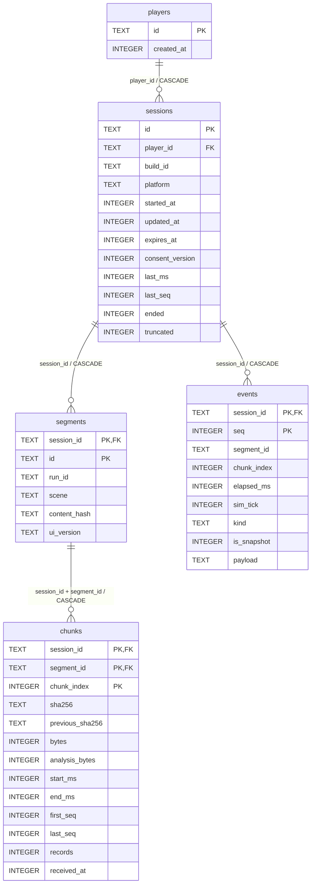

# Deviant ERD 및 데이터 설계서

| 항목 | 내용 |
|---|---|
| 기준 | 2026-11-16, `9bfde2398` |
| 목적 | 게임 데이터와 실제 수집 서버의 영속 데이터 관계 설명 |
| 물리 스키마 | [backend/collector/schema.sql](../../backend/collector/schema.sql), SQLite, schema version 1 |

## 1. 저장 영역과 책임

게임 진행 데이터는 클라이언트에, 플레이 수집 데이터는 서버에 저장한다.

| 영역 | 데이터 | 저장 방식·책임 |
|---|---|---|
| 편집 원본 | 무기·잉크·적·행동·성장·맵 정의 | `data/`의 JSON 등 → 생성기 → Unity 카탈로그 |
| 영구 프로필 | 마법안료·해금 등 런 외 성장 | 클라이언트 프로필, 플랫폼별 파일/Web 저장 |
| 런 상태 | 체력·무기·팔레트·가방·경제·보상 | 클라이언트 런 모델. 챕터 이동 시 유지, 중단 이어하기 저장 없음 |
| 수집 메타데이터 | 플레이어·앱 세션·기록 구간·조각·추출 사건 | Go 수집기의 SQLite |
| 리플레이 원본 | compact-v1 gzip 바이트 | 서버 파일 저장소 |

아래 ERD는 플레이 수집 서버의 테이블 관계다.

## 2. 물리 ERD

`schema_version`은 스키마 버전 1을 관리한다. `events.segment_id/chunk_index`는 원본 조각의 논리 참조다.

## 3. 엔티티 정의

### 3.1 players

| 컬럼 | 제약·의미 |
|---|---|
| id | PK, 플레이어 식별 UUID |
| created_at | NOT NULL, 최초 서버 등록 UTC epoch 밀리초 |

한 플레이어에 여러 앱 실행 세션이 연결된다.

### 3.2 sessions

| 컬럼 | 제약·의미 |
|---|---|
| id | PK, 앱 실행 세션 UUID |
| player_id | NOT NULL FK → players.id, ON DELETE CASCADE |
| build_id, platform | NOT NULL TEXT, 빌드 식별자와 실행 플랫폼 |
| started_at, updated_at, expires_at | NOT NULL INTEGER, 시작·마지막 갱신·만료 UTC epoch 밀리초 |
| consent_version | NOT NULL INTEGER, 수집 프로토콜 호환값 1 |
| last_ms, last_seq | NOT NULL, 기본 0. 클라이언트가 선언한 마지막 경과시간·순번 |
| ended, truncated | NOT NULL, 기본 0. 종료 관측·유실/중단 선언을 0/1로 표현 |

세션은 앱 실행 단위이며 마을과 여러 런을 포함한다.

### 3.3 segments

| 컬럼 | 제약·의미 |
|---|---|
| session_id, id | 복합 PK. session_id는 sessions.id FK, CASCADE |
| run_id | NOT NULL TEXT. 실제 런 ID, 런 외 구간은 빈 문자열 |
| scene | NOT NULL TEXT, 씬 식별 |
| content_hash, ui_version | NOT NULL TEXT, 해석에 필요한 콘텐츠·UI 버전 |

하나의 런에 여러 기록 구간이 연결된다.

### 3.4 chunks

| 컬럼 | 제약·의미 |
|---|---|
| session_id, segment_id, chunk_index | 복합 PK. 앞 두 값은 segments(session_id,id) 복합 FK, CASCADE |
| sha256, previous_sha256 | NOT NULL TEXT. 원본 바이트 해시와 구간 내 이전 조각 해시 |
| bytes, analysis_bytes | NOT NULL INTEGER. 압축 원본 크기와 분석 저장량 계산용 값 |
| start_ms, end_ms | NOT NULL INTEGER. session 시작 기준 실제 경과시간 |
| first_seq, last_seq, records | NOT NULL INTEGER. 전역 순번 범위와 레코드 수 |
| received_at | NOT NULL INTEGER. 서버 수신 UTC epoch 밀리초 |

원본 파일: `chunks/{session}/{segment}/{index:06d}.replay.gz`.

### 3.5 events

| 컬럼 | 제약·의미 |
|---|---|
| session_id, seq | 복합 PK. session_id는 sessions.id FK, CASCADE |
| segment_id, chunk_index | NOT NULL, 원본 조각 출처. 애플리케이션에서 연결 |
| elapsed_ms, sim_tick | NOT NULL INTEGER. 실제 경과시간과 전투 논리 tick |
| kind | NOT NULL TEXT. UI 활성화, 플레이어 명령/피격, 런·화면·장비·경제 상태 등의 종류 |
| is_snapshot | NOT NULL INTEGER. 구간 시작 상태와 실제 사건 구분 |
| payload | NOT NULL TEXT, CHECK(json_valid(payload)). 해석용 JSON |

기본 사건 조회는 실제 행동을 반환하며, 시작 상태는 snapshot으로 구분한다.

## 4. 인덱스와 데이터 관리

| 대상 | 인덱스·관리 기준 |
|---|---|
| 세션 조회 | sessions_player(player_id, started_at) |
| 만료 정리 | sessions_expiry(expires_at) |
| 기록 순서 | chunks_timeline(session_id, first_seq) |
| 사건 분석 | events_kind(kind, session_id, elapsed_ms) |
| 중복 업로드 | 동일 기록·동일 해시는 중복 성공, 다른 해시는 충돌 |
| 삭제 | 플레이어와 관련 세션·구간·조각·사건·원본 파일 삭제 |
| 보관 | 세션 시작 기준 30일 |

## 5. 시간과 수집 상태

| 항목 | 표현 |
|---|---|
| 저장 시각 | UTC epoch 밀리초 |
| API 시각 | RFC3339 문자열 |
| 기록 경과시간 | 세션 시작 기준 밀리초 |
| recorded_from / recorded_to | 기록 시작·종료 UTC |
| segment_created_at | UUIDv7 구간 생성 UTC |
| coverage_complete | 기록 연속성 충족 여부 |
| state | unknown_end(종료 미관측), partial(일부 누락), complete(완료), truncated(중단·유실) |

## 6. 연계 문서

[요구사항](requirements.md) · [API 설계](api-design.md) · [테스트 계획·결과](test-plan-results.md) · [수집 서버 상세](../development/telemetry/replay-server-storage.md)
